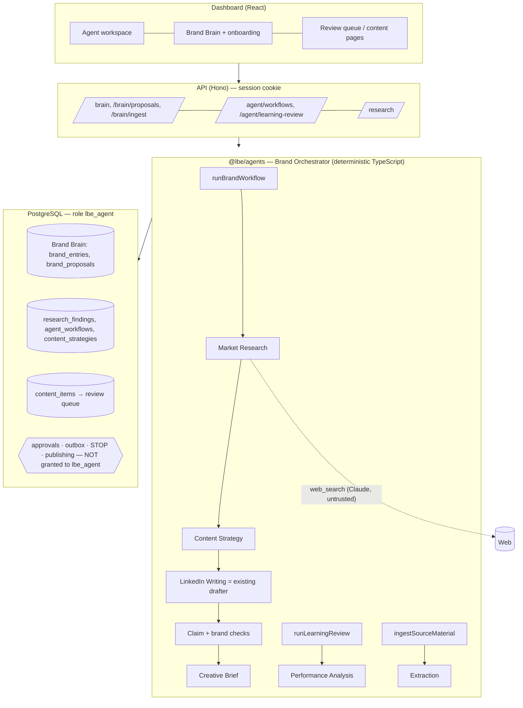

# Branding Agent — Architecture

_2026-11-19. Supplements ADR-018…021. Live LinkedIn actions are not part of this layer._

## 1. Layers

The execution platform (approvals, outbox, STOP, audit, publishing) is unchanged. The agent layer writes only
drafts, research, strategies, workflow records and **proposals**.

## 2. Brand Brain (persistent memory)

| Store | Content | Who writes | Notes |
|---|---|---|---|
| `lbe.brand_entries` | 14 sections × keyed entries: identity, positioning, messaging, icp (the **buyer** ICP), ideal_follower (who reads the content; P2-09, ADR-038), audience_problems, audience_language, voice_company, voice_founder, product, pillars_goals, prohibited (structured `terms`, `topics`), communication_rules, lessons | **Owner (admin) only**, directly or by accepting a proposal | Versioned; one current version per key; approved text immutable (trigger); never deleted |
| `lbe.brand_proposals` | Suggested changes with rationale, evidence (quotes / content ids), conflict pointer | Agents (`agent:<role>`) and editors (`user:<id>`) | Immutable once decided; owner can edit before accepting |
| `lbe.claims` | Verified claims with evidence (existing) | Editors draft; approvers verify | Now organization-scoped |
| `lbe.research_findings` | Statement, HTTPS source URL, title, publisher, published date, **retrieved_at**, confidence, stale, flags, review status | Agent (recorded), approver (accept/reject) | Never treated as claims until a human creates and verifies one |
| `lbe.content_items.topic` + 90-day history | Topic tracking for duplicate detection | Agent metadata | Not part of the publication package |
| `lbe.agent_workflows`, `content_strategies`, `agent_runs` | Goals, plans, results, every model call | Agent | Audit trail |

**Unknowns are explicit.** `brain_load` returns `missing_sections`, and the prompt context marks each missing
section `UNKNOWN — not yet provided by the owner. Do not invent anything for this section.`

**Single source of truth.** Knowledge lives in the database. The Phase 1 `brand/voice/*.md` files are an
import source: the owner clicks *Import brand/voice files*. Until then they are a read-only fallback, and the
workflow reports `voice_sources`.

**Portability.** Nothing depends on Claude Code memory. Every read goes through `lbe.brain_load(session)`,
which is organization-scoped, so the same code serves a future SaaS runtime.

## 3. Write-back authorization (enforced by the database)

| Action | admin | approver | editor | `lbe_agent` role |
|---|---|---|---|---|
| Read own org's Brand Brain | ✅ | ✅ | ✅ | ✅ |
| Write / retire approved knowledge | ✅ | ❌ | ❌ | ❌ (no grant) |
| Propose a change | ✅ | ✅ | ✅ | ✅ |
| Accept / reject proposal | ✅ | ❌ | ❌ | ❌ (no grant) |
| Create drafts, submit for review | ✅ | ✅ | ✅ | ✅ |
| Approve, enqueue, release, resume STOP, verify claims, enable live | per Phase 1/2 rules | per rules | ❌ | ❌ (no grant) |
| Read any table directly | ✅ (API role, own org filtered) | | | ❌ |

## 4. Specialists

All specialists return untrusted output that is checked against strict Zod schemas (unknown keys rejected) and
then by deterministic validators in `services/agents/src/validate.ts`. Claude versions use the Messages API
with structured outputs and **no client tools**. Mock versions are deterministic and offline.

| Role | Responsibility | Input → Output schema | Data sources | Tools | Boundaries | Failure handling | Evaluation |
|---|---|---|---|---|---|---|---|
| Brand Orchestrator | Sequence the workflow; onboarding extraction | `WorkflowInput` → workflow result; `ExtractionInput` → `ExtractionOutputSchema` | Brand Brain, findings, decisions | none (code) | `lbe_agent` grants only | Research optional; strategy required; per-draft errors recorded | Integration tests |
| Market Research | Sourced findings | `ResearchInput` → `ResearchOutputSchema` | Web (Claude `web_search`) | server-side web search | URLs must be among tool-returned URLs; injection flagged | Continue without research, with a warning | HTTPS, freshness ≤24 months, traceability |
| Content Strategy | 3–5 item plan, pillars per account | `StrategyInput` → `StrategyOutputSchema` | Brand context, usable findings, verified claims, recent topics | none | IDs must exist; prohibited / duplicate topics dropped | Workflow fails safely | Duplicates dropped, valid pillars |
| LinkedIn Writing | One post per account voice | `DraftInput` → `DraftOutputSchema` | Voice, brand context, item claims, findings as untrusted source | none | Claim gate, detector, prohibited terms | Draft held, error recorded | 0 unsupported statements, voice check |
| Creative Brief | Designer brief | `CreativeInput` → `CreativeOutputSchema` | Post text, identity section | none | No new claims (detector) | Brief omitted | Validator warnings |
| Performance Analysis | Lesson proposals | `PerformanceInput` → `PerformanceOutputSchema` | `learning_inputs` (decisions, outcomes; no metrics) | none | Proposals only; evidence must be real | Error returned | Evidence-linked, actionable |

Prototypes of each role for Claude Code are in `.claude/agents/`.

## 5. Workflow

Goal → `workflow_create` → `brain_load` → research (validated, recorded with `retrieved_at`) → strategy
(validated, deduplicated, saved) → for each item × {company page, founder}: `create_content` → writer →
`validateDraftOutput` + `checkBrandRules` → `set_draft_output` → creative brief → `set_agent_metadata` →
`submit_for_review` **only if nothing blocks** → result with research summary, plan, drafts, visual briefs and
claims report → `workflow_finish`. Publishing then follows the existing human path: approve, then queue, then
the publisher, which is mock unless live is separately enabled.

Learning: `learning_inputs` → Performance Analysis → `brain_propose` → owner accepts or rejects in the Brand Brain.

## 6. Runtime evaluation (Phase F)

| Criterion | A. Messages API + deterministic coordinator | B. Claude Agent SDK | C. Claude Managed Agents |
|---|---|---|---|
| Fit with current TypeScript code | **Native** — same SDK (already used by the drafter), plain functions | Claude Code harness with filesystem/shell tools; a poor fit for a multi-tenant web service | Separate hosted agents and sessions; new control plane |
| Persistent memory | **Our database** (Brand Brain) | Our database plus agent-local files | Hosted session history plus memory stores (outside our database unless mirrored) |
| Tool execution | Server-side `web_search` only; no client tools | Built-in Read/Write/Bash/etc. (must be locked down) | Hosted sandbox per session |
| Human approval | Existing database gates; agent role cannot bypass them | Hooks can deny tools, but approvals still need our database | Permission policies plus our database gates |
| Cost / rate limits | Pay per call; lowest overhead | Same model cost plus heavier context | Tokens plus session runtime billing |
| Tenant isolation | **Database-enforced per organization** | Process/file isolation is ours to build | Per-session containers; tenancy mapping is ours to build |
| Hosting & data privacy | Data stays in our database; only prompts go to the API | Self-hosted harness | Session data held by Anthropic until deleted |
| Beta dependencies | Structured outputs (GA), server-side fallback (beta, optional) | Separate product | Managed Agents (beta) |
| Operational complexity | **Lowest** | Medium/high | Medium (new surface) |

**Decision: A** (ADR-020). The workflow is a code-controlled pipeline, not open-ended model-driven exploration.
Revisit C if the product later needs long-running autonomous research sessions per tenant.

## 7. SaaS migration plan (from today's partial tenancy)

| Step | Work | Notes |
|---|---|---|
| 1 | Remove `lbe.default_org_id()` defaults; require explicit `organization_id` on every insert | Signup and onboarding create the organization first |
| 2 | Add `organization_id` (or derive it) to `content_items`, `publication_outbox`, `audit_events`, `agent_runs`, `control_flags`, `linkedin_credentials` | Backfill from the account |
| 3 | Row-level security by organization on every table read by `lbe_api` (policy on a session-bound org setting), and org filters on the remaining API views (audit, mock posts, controls, capabilities) | Today's memory tables already allow definer access only |
| 4 | Users in multiple organizations (memberships table) | Today: one organization per user |
| 5 | Per-tenant LinkedIn apps or partner approval; customer is controller, we are processor (DPA) | ADR-001 Mode B |
| 6 | Per-tenant AI cost limits and usage metering (`agent_runs.input_tokens/output_tokens` already recorded) | — |
| 7 | Background job queue for long Claude workflows (today synchronous per request) | Workflows are already recorded with status |
| 8 | Replace n8n-licensed assumptions (none used) and confirm the Docker Desktop licence for team use | ADR-002 |
