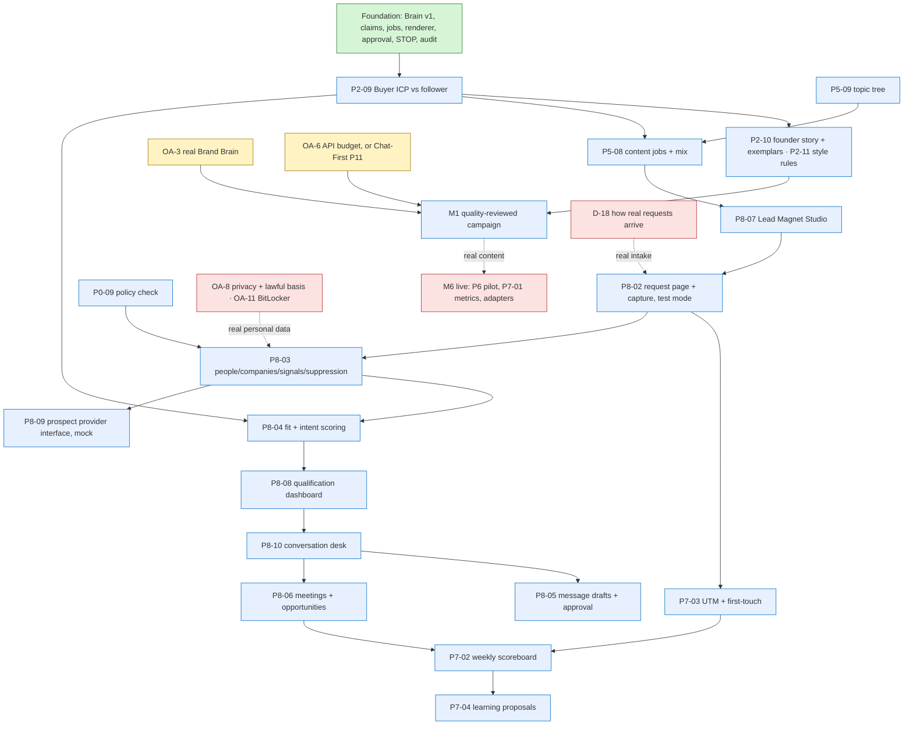
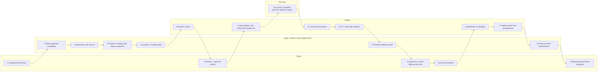

# Reference gap analysis: GTM engine vs the existing system (M0)

_Written 2026-11-20 on branch `develop` from `main` at `4a2b5ca`. Task P0-08. Plan: [`plan.md`](../plan.md) §E2
(milestones M0–M8) and §F (task IDs). Proposed decisions: ADR-037 … ADR-043 in
[`decisions/ADR-log.md`](decisions/ADR-log.md)._

**Source limitation (read first).** The business blueprint (*LinkedIn Personal Brand Engine*, OneGTMLab, pages
00–09, plus the *Claude + Prospeo Sales System* supplement) is **not on this PC**. The full user profile was
searched for it on 2026-11-20. This analysis is therefore built from the page outline in the owner's master
prompt, which names each page's subject. When the owner supplies the document (owner action OA-13), every row
is rechecked against the page itself. The reference is a **requirements source only**: none of its text,
prompts or templates are copied into the product.

Statuses: **IMPLEMENTED** (exists and is tested; real use noted separately) · **PARTIAL** · **MISSING** ·
**BLOCKED** (needs an owner decision, external approval or is prohibited) · **DEFERRED** (deliberately later).
Priority: **P0** next milestone cannot pass without it · **P1** needed in its milestone · **P2** improves it ·
**P3** later.

---

## 1. Executive review

**What is already built (verified today, not taken from earlier reports).** The foundation of a governed content
system is in place and tested:
- a versioned, owner-approved Brand Brain (13 sections) with AI proposals only;
- a verified-claims register with evidence rules;
- research with source URLs, contradiction checks and injection flags;
- monthly campaigns run as durable, resumable agent jobs;
- two writing voices;
- branded images and PDF carousels approved together with the post;
- an immutable approval package, a publishing outbox, three-level STOP and a full audit trail;
- backups, system health and a read-only Claude connector.

Baseline today: typecheck ✅ · Vitest 503 passed (11 skipped) ✅ · real PostgreSQL 11/11 ✅ · Playwright 21/21 (incl.
accessibility) ✅ · secret scan (246 files) ✅ · `npm audit` 0 ✅.

**What it has not done in real life.** No real Claude call has run: the AI is mock, by owner decision D-06. Nothing
has been published to LinkedIn: the founder app is paused (OA-4) and the company app is not applied for (OA-5).
Staging holds no real Brand Brain content (OA-3). Tests prove the controls; they do not prove content quality.

**What is missing.** Everything after the post:
- Brand Brain: the buyer ICP and the ideal follower are one section; there is no founder story, exemplar library
  or structured style rules.
- Content: no content jobs (Attract/Teach/Prove/Convert) and no topic tree.
- Funnel: no lead magnets, no capture, no people/companies/signals, no fit/intent scoring.
- Sales: no conversation desk, meetings, opportunities or attribution.
- Reporting: no weekly scoreboard, and learning comes from approval decisions only.

These are the reference's pages 02–08.

**What must be redesigned, not copied.** Turning people who liked or commented into leads is **prohibited**: the
LinkedIn API Terms already appear in our capability register as `engagement_to_leads: prohibited`. Scraping,
browser automation and automated DMs are also prohibited (User Agreement §8.2; the Messages API is
partner-only). The compliant design:
- **first-party signals:** our own request page, inbound email, meetings, and conversations the prospect started;
- **aggregate LinkedIn metrics only**, and only where an approved API product allows them;
- **copy-ready messages** that the owner sends by hand.

See §3.

**Two blockers that are not code:**
- **D-18:** under D-13 the server answers only on this PC, so a public lead-magnet form cannot reach it. Recommended:
  the website's own form, imported into the system, first.
- **UK GDPR/PECR:** a privacy notice, lawful basis and retention (OA-8, D-11) are required **before any real
  personal data**, and BitLocker (OA-11) should be on before lead data is stored.

Every lead feature is built and demonstrated on **synthetic test data and mock providers first**.

**Recommended sequence:**

| Step | Milestone | What |
|---|---|---|
| 1 | M1 | Brand Brain v2, starting today with buyer ICP vs ideal follower |
| 2 | M1 | One quality-reviewed campaign. This needs real content (OA-3); it can run with **zero API spend through the Chat-First connector** (P11), or with a capped API budget (OA-6) |
| 3 | M2 | Content jobs and the topic tree, then lead magnets, then capture, then UTM attribution |
| 4 | M3 | Lead data model, signals, deterministic fit/intent scoring |
| 5 | M4 | Conversation desk, meetings, opportunities |
| 6 | M5 | Weekly scoreboard and learning |
| 7 | M6 | Live integrations |
| 8 | M7 | Internal production |
| 9 | M8 | SaaS |

Chat-First stays a parallel track throughout.

---

## 2. Gap table

Evidence paths are relative to the repository. "Mock-tested" means automated tests with fake providers.

### Page 00 — Second Brain (brand knowledge)
| # | Reference capability | Status | Existing implementation | Missing capability | Required change | Priority | Dependencies | Acceptance test |
|---|---|---|---|---|---|---|---|---|
| R-01 | Persistent brand memory, owner-approved, versioned | IMPLEMENTED (staging content empty) | `brand_entries` + `brand_proposals` (migration 0500), onboarding wizard (P2-02), grounded document/PDF ingest (P2-03/b), `brain:audit` | Real ActTrident content | None in code; owner enters content | P0 | OA-3 | `npm run brain:audit:staging`: no required section UNKNOWN, no `[SYNTHETIC]` |
| R-02 | Buyer ICP (company traits, decision-maker roles, buying problems, geography, verified buying criteria, exclusions) | PARTIAL | One `icp` section ("Ideal customer profiles", 2 free-text questions) + `audience_problems` | The six buyer fields; any distinction from followers | Rename to *Buyer ICP*; six guided questions; structured fields kept in `structured` | P0 | — | Owner enters each field; agents receive them under a "Buyer ICP" heading; domain/DB section lists match |
| R-03 | Ideal follower (who values the content, topics they follow, their language and questions, how they influence buyers), distinct from the buyer | MISSING | — | Whole section | New `ideal_follower` section (required); separate questions; agents receive it separately from the buyer and are told they differ | P0 | R-02 | Section editable and auditable; strategy context contains both, distinct; extraction can propose it with a source quote |
| R-04 | Founder story and genuine opinions | PARTIAL | `voice_founder` asks for tone and topics | Story, beliefs, contrarian views, written or approved by the founder | New `founder_story` section; agents may only propose it from owner-supplied text with a verbatim quote | P1 | R-03 | Proposal without a quote refused; founder drafts may cite only approved entries |
| R-05 | Company positioning and messages | IMPLEMENTED | `positioning`, `messaging` sections | — | — | — | OA-3 | (existing tests) |
| R-06 | Two distinct voices (company, founder) | IMPLEMENTED | `voice_company`, `voice_founder`, voice-file import, validator warns on I/we mix-ups (`services/agents/src/validate.ts`) | Voice quality unmeasured with a real model | — (measured in M1 campaign) | P1 | M1 campaign | Human scoring sheet shows the voices are distinguishable |
| R-07 | Authentic best-performing posts (exemplars) | PARTIAL | Voice questions ask to "paste 3–5 example posts" as free text | Per-post library: text, account, link, date, why it worked, metric source; used as style reference with originality guard | `exemplar_posts` section (one entry per post) + writer input + overlap check against exemplars | P1 | R-03 | Writer sees exemplars; a draft copying an exemplar (> 0.25 overlap) is held |
| R-08 | Rejected drafts and rejection reasons | PARTIAL | `content_approvals` stores rejected / changes requested + note; learning review proposes lessons (`/agent/learning-review`) | Reason categories; rejected examples fed to the writer as "avoid" | Reason category on decision; writer input "recently rejected because…" | P2 | — | Rejection with category stored; next writer call receives it; learning cites it |
| R-09 | Audience language from authorized sources | PARTIAL | `audience_language` free text | Per-phrase provenance (call notes, survey, inbound email) and permission | Structured phrases with `source`, `permission` | P2 | R-03 | Phrase without a source refused |
| R-10 | Pillars → topics → subtopics | PARTIAL | Pillars per account (P2-01, 1–8 slugs); topic is free text per post | Owner-approved topic tree; subtopic on every plan item | `topic_nodes` (pillar → topic → subtopic), strategy picks from it | P1 | — | Plan items reference tree nodes; unknown node refused |
| R-11 | Verifiable proof and approved claims | IMPLEMENTED (no real claims yet) | `claims` (verified needs evidence + verifier, expiry), `content_claims` with quoted span, restatement check (ADR-025), research → draft claim | Real verified claims | — | P0 | OA-3 | (existing tests); 3–5 real verified claims in staging |
| R-12 | Prohibited statements, sensitive topics | IMPLEMENTED | `prohibited` section with term list enforced by validators | Sensitive topics are free text only | Optional: structured sensitive-topic list | P3 | — | (existing tests) |
| R-13 | Every factual statement carries source + verification status | PARTIAL | Claims and research findings carry both; Brand Brain entries carry `source`/`source_ref` but no verification status | Facts inside narrative entries are unchecked | Factual-looking text in entries (figures, %) is flagged unless linked to a verified claim | P2 | R-11 | Entry with "40% of…" and no claim link is flagged on save |
| R-14 | Approved weekly learnings; AI proposes, owner approves | PARTIAL | `lessons` section; learning review proposes to `lessons`/`communication_rules` from approval decisions only; `lbe_agent` cannot approve | Weekly cadence; inputs from results, questions, objections, meetings; targets ICP/language/pillars | See R-41 | P1 | M5 | See R-41 |
| R-15 | Owner-approved style rules (length, punctuation, formatting, banned language), not one fixed house style | PARTIAL | `communication_rules` free text passed to the writer; prohibited terms enforced; length limits hard-coded (3,000 chars) | Structured, per-account rules enforced deterministically | `style_rules` entry (word range, hashtag/emoji limits, banned punctuation/phrases) + validator | P1 | — | A draft breaking an owner rule is flagged with the rule named |

### Page 01 — Top-of-funnel content
| # | Reference capability | Status | Existing implementation | Missing capability | Required change | Priority | Dependencies | Acceptance test |
|---|---|---|---|---|---|---|---|---|
| R-16 | Market research with verifiable sources | IMPLEMENTED (mock-tested; never run live) | Research specialist with `web_search`, findings with URL/date/confidence, contradictions, injection flags (ADR-025); review + to-claim in dashboard | A real run | None in code (OA-6), or Chat-First research P11-01b | P0 | OA-6 or P11-01b | A real run stores findings with working source URLs |
| R-17 | Campaign planning | IMPLEMENTED | Monthly campaigns as weekly durable jobs, objective (awareness / engagement / thought leadership / lead generation / event), pillar rotation (P5-05, ADR-031) | — | — | — | — | (existing tests) |
| R-18 | Four content jobs: ATTRACT, TEACH, PROVE, CONVERT, with a configurable mix | MISSING | Campaign-level objective; plan item `objective` is free text | Job per post; owner-set mix per campaign; job-specific rules | `content_job` on plan items and posts; mix on campaign; PROVE needs ≥ 1 verified claim; CONVERT needs a CTA to a lead magnet or booking link | P0 | R-10 | Plan honours the mix (±1 post); PROVE without claim and CONVERT without CTA are refused |
| R-19 | Planned post fields: account, buyer/follower audience, campaign, pillar/topic/subtopic, job, one objective, sources, claims, hook options, voice, CTA, format, status, attribution | PARTIAL | Account, pillar, topic, finding/claim ids, visual format (creative brief), status, workflow link | Audience, subtopic, job, hook options, CTA, campaign id on the post, attribution | Strategy schema v3 + post columns; shown in review | P0 | R-03, R-10, R-18 | Every agent post shows all fields in review; schema test |
| R-20 | Repetition check against recent posts | PARTIAL | Recent topics passed to the strategist; opening reuse avoided (writer v3); topic similarity < 0.5 in campaigns | Subtopic- and hook-level checks against the last N published/approved posts | Extend checks to subtopic + hook | P2 | R-10 | Repeated subtopic within N weeks flagged |
| R-21 | Hook options | MISSING | One body per post | 2–3 hook options; reviewer picks | Writer returns options; chosen hook stored in the package | P2 | R-19 | Reviewer can switch hooks; changing it needs re-approval |
| R-22 | Visual production | IMPLEMENTED | Render service, brand templates, alt text required, visuals inside the approval package (P5-01…06) | — | — | — | — | (existing tests) |

### Page 02 — Lead magnets and nurture
| # | Reference capability | Status | Existing implementation | Missing capability | Required change | Priority | Dependencies | Acceptance test |
|---|---|---|---|---|---|---|---|---|
| R-23 | Create lead magnets (templates, checklists, guides) from approved material, versioned | MISSING | PDF renderer exists (P5-01) | Lead Magnet Studio | `lead_magnets` + immutable versions; generated from approved Brand Brain + verified claims; rendered to PDF; owner approval per version | P1 | R-11, renderer | Magnet version approved → PDF downloadable; editing makes a new version needing approval |
| R-24 | Link magnets to campaigns and CONVERT posts | MISSING | — | Link + CTA URL with UTM | Magnet id on CONVERT plan items; CTA URL generated | P1 | R-18, R-23, R-27 | CONVERT post package contains the magnet URL with UTM |
| R-25 | First-party request page / download form | MISSING; **real intake BLOCKED (D-18)** | — | Page + capture | Local test page served by the API (test mode); real intake per D-18 (recommended: website form → import) | P1 | R-23, D-18 | Test user requests the magnet on the local page → request recorded with consent text version |
| R-26 | Record requests with consent / lawful basis | MISSING; **real data BLOCKED (OA-8, D-11)** | Design draft in `docs/integration-contracts.md` (people, consent fields) | Requests, consent records, privacy-notice version | `lead_requests`, `consent_records` | P1 | P8-01 for real data | Request without consent checkbox refused; notice version stored |
| R-27 | Delivery and follow-up status | MISSING | — | Delivery record, follow-up state | Delivery = download link (manual email first: copy-ready text); state machine requested → delivered → followed up | P2 | R-25 | Delivery recorded; follow-up appears in the desk |
| R-28 | Nurture sequences (email) | DEFERRED | — | Email provider, PECR consent for marketing | After D-20 (email provider) and OA-8 | P3 | D-20, OA-8 | — |
| R-29 | "Comment a keyword to get the guide" | BLOCKED (platform) → redesigned | Capability register: founder comment reading unverified; member data never for lead generation | Automatic capture from comments | Not built. CONVERT posts link to the request page. A person who asks by DM or email is entered by hand as a manual request, with source and lawful basis, only if D-21 allows | P2 | D-21 | — |

### Page 03 — Engagement signals
| # | Reference capability | Status | Existing implementation | Missing capability | Required change | Priority | Dependencies | Acceptance test |
|---|---|---|---|---|---|---|---|---|
| R-30 | Collect who liked/commented/viewed and treat it as intent | BLOCKED (prohibited) | Capability register `engagement_to_leads: prohibited`, `scraping_or_browser_automation: prohibited` (`packages/domain/src/capabilities.ts`) | — | **Not built.** Replaced by R-31 | — | — | Capability register still shows prohibited; no code reads member engagement for leads |
| R-31 | Signal record with provenance (source, event type, date, campaign/post, evidence ref, collection permission, retention) | MISSING | — | First-party signals: magnet request, site visit via UTM (with consent), inbound email/form, meeting booked, conversation the prospect started, manual note | `signals` table with all provenance fields and a retention date; source must be on an allow-list (no LinkedIn member data) | P0 | R-33 | Signal without source/permission refused; LinkedIn-API-derived source refused; retention date computed |
| R-32 | Aggregate post engagement for content learning (not per person) | BLOCKED (OA-5 / founder unverified) | Capability register | Metrics | P7-01 via Community Management API (company page) once approved; meanwhile owner types totals from LinkedIn's own UI, labelled *imported* (R-40) | P2 | OA-5 | — |

### Page 04 — Separate fit and intent qualification
| # | Reference capability | Status | Existing implementation | Missing capability | Required change | Priority | Dependencies | Acceptance test |
|---|---|---|---|---|---|---|---|---|
| R-33 | People, companies, leads with provenance and verified-identifier dedup | MISSING | Design draft (integration-contracts §1 lead side); P8-03 planned | Schema | Normalized `people`, `companies`, `leads`, `identifiers` (email, company number, domain) with source; dedup only on verified identifiers; weak matches (name) → merge-review queue | P0 | ADR-040 | Two signals with the same verified email → one person; same name, different email → review item, not merged |
| R-34 | FIT score vs approved Buyer ICP (0–10 starting point, owner-configurable weights) | MISSING | — | Rubric, evaluation | Versioned rubric from R-02 fields; per-criterion value, evidence, missing info, date, rubric version, confidence/UNKNOWN, plain-English reason | P0 | R-02, R-33 | Unknown criterion stays UNKNOWN (not 0); rubric change re-scores with new version; reason text lists evidence |
| R-35 | INTENT score from recent permitted signals | MISSING | — | Rubric over R-31 signals with recency decay | Same structure as FIT; only allow-listed signal sources count | P0 | R-31 | Old signal decays; prohibited source cannot exist to count |
| R-36 | Verdicts (Act now / Warm first / Nurture / Enrich first / Disqualified); exclusions and suppression first; human gate to outreach | MISSING | — | Verdict rules; outreach queue gate | Deterministic verdict; suppression/exclusion check first; moving to the outreach queue is a human action enforced in the database (`lbe_agent` cannot) | P0 | R-34, R-35, R-44 | Suppressed person always "Disqualified"; agent role refused moving to queue |

### Page 05 — Signal-led outreach
| # | Reference capability | Status | Existing implementation | Missing capability | Required change | Priority | Dependencies | Acceptance test |
|---|---|---|---|---|---|---|---|---|
| R-37 | Outreach drafts tied to a signal, in the approved voice, using verified claims | MISSING | Writer + claim checks for posts | Message drafts | `message_drafts` reuse voice and claim validators; copy-ready output | P1 | R-36, R-38 | Draft cites its signal; unverified claim refused; approve → copy-ready text; "sent" recorded only by a human |
| R-38 | Auto-connection requests, engagement bots, automated DMs | BLOCKED (prohibited) | Capability register `direct_messages: not_supported` | — | **Not built.** Any future provider sits behind ADR-042's release gate | — | — | — |
| R-39 | UK B2B email outreach rules (PECR corporate vs sole trader / partnership) | MISSING; **BLOCKED for real use (OA-8)** | `entity_type` idea in design draft | Rule per recipient type | Recipient type on company; email drafts to individual subscribers need consent | P1 | OA-8 | Draft to a sole trader without consent refused |

### Page 06 — DM desk (conversations)
| # | Reference capability | Status | Existing implementation | Missing capability | Required change | Priority | Dependencies | Acceptance test |
|---|---|---|---|---|---|---|---|---|
| R-40 | Unified conversation desk: inbound, magnet requests, manually imported conversations, stages OPEN → QUALIFY → PIVOT → BOOK, owner, next-action date, stop/suppression, source | MISSING | — | Whole desk | `conversations`, `messages` (direction, channel, imported/drafted/approved/sent-manually), stage machine, owner, next action; manual import labelled | P1 | R-33 | Stage moves audited; suppressed conversation cannot get a new draft |
| R-41 | AI reply suggestions with evidence and uncertainty; human approval for every external message | MISSING | Approval/claims machinery for posts | Reply suggestions | Agent proposes `message_drafts` only; DB refuses "approved/sent" from the agent role; evidence + uncertainty shown | P1 | R-40 | Agent cannot approve; approval binds the exact text (hash) as for posts |

### Page 07 — Booked calls and learning
| # | Reference capability | Status | Existing implementation | Missing capability | Required change | Priority | Dependencies | Acceptance test |
|---|---|---|---|---|---|---|---|---|
| R-42 | Booking link, meeting records with source campaign/post/magnet, problem and qualification notes, outcome, follow-ups | MISSING (P8-06 planned) | — | Meetings | `meetings` linked to person/company/conversation and first touch; booking link in settings; no invites sent by the system | P1 | R-40 | Meeting recorded → attributed to the originating campaign |
| R-43 | Opportunities, stages, revenue when recorded | MISSING | — | Opportunities | `opportunities` with stage history; revenue only when entered and marked verified | P1 | R-42 | Revenue appears in reports only when verified |
| R-44 | Suppression across all channels | MISSING | — | Suppression list | `suppressions` (hashed identifier, reason, scope, date) checked by every draft/approve/import function | P0 | R-33 | Suppressed email blocks request follow-up, drafts and imports |

### Page 08 — Weekly operating rhythm
| # | Reference capability | Status | Existing implementation | Missing capability | Required change | Priority | Dependencies | Acceptance test |
|---|---|---|---|---|---|---|---|---|
| R-45 | Weekly scoreboard (posts, by job, engagement, magnet requests, deliveries, inbound/qualified leads, conversations, positive replies, meetings, opportunities, revenue) | MISSING (P7-02 planned for content only) | Run history, publishing outbox | Scoreboard | Weekly report from stored data only; each number labelled verified / imported / estimated; missing = "not available", never 0 | P1 | R-31…R-43 | Report matches recorded test outcomes exactly; missing LinkedIn metrics shown as unavailable |
| R-46 | Attribution: UTM, first-touch (optional multi-touch), content → lead → meeting → revenue, campaign ROI where costs known | MISSING (P7-03 planned) | — | UTM builder, touch records | `attribution_touches`; UTM on CTA links; first-touch default | P1 | R-24, R-31 | Request via UTM link → lead's first touch = that post |
| R-47 | Closed-loop learning from results, questions, objections, lost deals, meetings → proposals to ICP, language, voice, pillars, planning | PARTIAL | Learning review from approval decisions (lessons, communication rules) | Inputs and target sections | Extend learning inputs and allowed target sections; still proposals only (`lbe.brain_propose`); verified claims never touched | P1 | R-45 | Proposal cites the meetings/objections it used; owner approves/rejects; claims unchanged |

### Page 09 — Prompt library
| # | Reference capability | Status | Existing implementation | Missing capability | Required change | Priority | Dependencies | Acceptance test |
|---|---|---|---|---|---|---|---|---|
| R-48 | Reusable prompts for each job | PARTIAL | Versioned specialist prompts in code (writer v3, strategy v2, creative v2; `docs/prompt-review.md`); brand-chat instructions `tools/claude-brand-chat/CLAUDE.md` | Owner-visible chat playbooks for Chat-First mode | Our own playbooks (research a topic, plan a week, draft from a finding) for the Chat-First connector; **no reference prompts copied** | P3 | P11-01b | Playbook runs in Claude chat using only connector tools |

### Supplement — Claude + Prospeo sales system
| # | Reference capability | Status | Existing implementation | Missing capability | Required change | Priority | Dependencies | Acceptance test |
|---|---|---|---|---|---|---|---|---|
| R-49 | Teach Claude the business | IMPLEMENTED | Brand Brain + `get_brand_brain` connector (P11-01a) | — | — | — | — | (existing tests) |
| R-50 | Company discovery resembling the ICP; explain company-level fit; suggest buyer **roles** | MISSING | — | Provider-independent interface | `ProspectProvider` interface + mock fixtures; results enter the review queue as companies with provenance; roles suggested, not people | P2 | R-33, R-34 | Mock search → companies with fit explanation in review queue; nothing auto-contacted |
| R-51 | Contact discovery and email verification via a data vendor | BLOCKED (D-22, OA-8) | — | Vendor licensing, DPA, cost, lawful basis | No vendor, credits or connector until owner approves after review | P3 | D-22 | — |
| R-52 | Export prospects | MISSING | — | Export into our review queue; CSV export for the owner | Export only selected, non-suppressed records; audited | P3 | R-50 | Export excludes suppressed; audit row written |

### Cross-cutting
| # | Reference capability | Status | Existing implementation | Missing capability | Required change | Priority | Dependencies | Acceptance test |
|---|---|---|---|---|---|---|---|---|
| R-53 | Human approval, STOP, audit for every external action | IMPLEMENTED for posts | DB-enforced approval package, outbox, STOP levels, audit (ADR-004/014/022), PG concurrency tests | Same gate for messages and magnet delivery | Reuse the package-hash approval for `message_drafts` | P0 (with R-41) | — | (existing) + R-41 |
| R-54 | Mode A Chat-First (Claude interface + restricted MCP) | PARTIAL | Read-only `get_brand_brain` verified with Claude Code (P11-01a); browser view waits on the Team-plan Remote Control toggle | Write tools (research, proposals, drafts) | P11-01b, then drafts | P1 (parallel) | Owner toggle | P11 acceptance in plan |
| R-55 | Mode B automated API | IMPLEMENTED (mock) | Durable jobs, budgets, pricing verified (P3-01) | Real run | — | P1 | OA-6 | Paid run within cap |
| R-56 | Shared schemas/validators/DB functions across both modes | PARTIAL | Connector reuses the DB function layer | Write path not built | P11 write tools call the same functions/validators | P1 | P11-01b | Same validator test passes for both entry points |
| R-57 | LinkedIn publishing (mock, then authorized account) | IMPLEMENTED (mock); live BLOCKED | Mock provider, live provider contract-tested, pilot runbook | Live pilot | P6-01…03 (owner paused) | P1 (M6) | OA-4 | Pilot log signed |
| R-58 | Privacy: lawful basis, notices, minimization, retention, export/deletion, objections | MISSING | — | Policies + functions | P8-01 docs (owner/legal); retention job, subject export/delete, objection → suppression | P0 before real lead data | OA-8 | Delete request removes personal data, keeps hashed suppression; retention job tested |
| R-59 | Encryption and secrets | PARTIAL | Token AES-GCM, secrets outside Git, System health checks | Disk not encrypted | OA-11 BitLocker before lead data | P0 before real lead data | OA-11 | System health shows encryption on |
| R-60 | Cross-tenant isolation for SaaS | PARTIAL / DEFERRED | org id + definer checks on every route (ADR-023) | RLS second layer etc. | Phase 10 | P3 | M8 | — |
| R-61 | Prompt-injection handling for third-party content | IMPLEMENTED for research and documents | Flags, data-only handling (ADR-025) | Imported conversations, form fields | Same treatment for imports and form text | P1 | R-40 | Injected instruction in a form field is stored as data and flagged |

---

## 3. Where the reference's method is replaced

| Reference method | Why not | Our alternative |
|---|---|---|
| Harvest likers/commenters/profile viewers as leads | LinkedIn API Terms (member data never for prospecting/CRM); scraping banned (User Agreement §8.2) | First-party signals only (R-31); aggregate metrics for content learning (R-32) |
| Comment-keyword lead capture | Founder comment API unverified; member data not for lead generation | CONVERT post links to our request page; direct requests entered by hand only if D-21 allows |
| Automated connection requests, DMs, engagement tools ("safe daily limits") | Not permitted regardless of a vendor's limit; Messages API partner-only | Copy-ready approved messages sent by the owner by hand (R-37, R-41) |
| Raw profile JSON stored per prospect | Data minimization (UK GDPR Art. 5(1)(c)) | Normalized fields we need, each with source and retention (R-33) |
| Notion / Supabase / n8n / LangGraph as infrastructure | One system of record; business rules in our database (ADR-037) | Existing PostgreSQL + Hono + durable jobs; optional adapters later |
| Contact-data vendor credits by default | Cost, licensing, lawful basis | Provider interface + mock first; vendor only after D-22 |

Verification of these platform and legal points against current sources is task **P0-09** (before M3 code). The
capability register entries above were last checked in Phase 2.

---

## 4. Dependency map

Solid arrows are build order; dotted arrows gate **real** use only (test data and mocks are not blocked).

---

## 5. User journey (acceptance scenario)

First with synthetic data and mock providers (M2–M5), then a real owner-approved pilot with authorized providers
only (M6).

---

## 6. Owner decisions and external approvals

| ID | Decision / approval | Needed for | Recommendation | Who |
|---|---|---|---|---|
| D-17 | Adopt the reference as a requirements source and the M0–M8 milestone scheme | Plan | Yes (this document) | Owner |
| D-18 | How real lead-magnet requests reach the system while it runs only on this PC (D-13) | M2 real intake | (a) website's own form, entries imported (CSV or mailbox), first; (b) small hosted capture endpoint later; (c) exposing this PC: not recommended | Owner |
| D-19 = D-11 / OA-8 | Privacy notice, lawful basis (consent vs legitimate interests), LIA, retention periods | Any real personal data (M2 real intake, M3+) | Engage a privacy adviser; templates prepared by Claude for review | Owner + legal |
| D-20 | Email delivery for resources and follow-ups | Automatic delivery, nurture | Manual copy-ready first; transactional provider later | Owner |
| D-21 | May the owner enter, by hand, people who asked directly (DM/email) for a resource or conversation? | R-29, R-40 imports | Yes for people who contacted ActTrident directly, with source + lawful basis recorded; never from LinkedIn API or scraping | Owner + legal |
| D-22 | Prospect-data vendor (e.g. Prospeo): licensing, DPA, cost, lawful basis | R-51 | Not now; mock interface only | Owner |
| D-23 | Default content mix and style rules (per account) | M2 | Owner sets; system ships with no house style | Owner |
| D-24 | Fit/intent rubric v1 and weights | M3 | Claude proposes from the Buyer ICP; owner approves the version | Owner |
| D-25 | Booking link / calendar or CRM adapters (Calendly, HubSpot, …) | M4 optional | Booking link only (no integration) first | Owner |
| OA-13 | Supply the reference PDF (kept in the git-ignored `private-reference/` folder; never committed) | Recheck every row against the pages | — | Owner |
| Existing | OA-3 real Brand Brain · OA-6 API budget · OA-4/OA-5 LinkedIn apps · OA-7 scheduled-release legal question · OA-11 BitLocker · OA-1 USB copy · Remote Control toggle (P11) | Various | See `owner-action-checklist.md` | Owner |
| External | LinkedIn Community Management API approval (company page analytics/comments) · legal advice (PECR, LinkedIn terms) · vendor DPAs | M6 | Start OA-5 early (weeks) | LinkedIn, legal, vendors |
