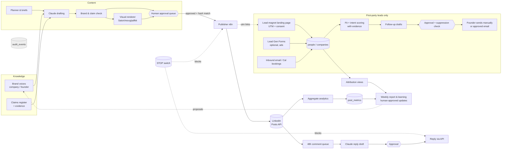

# Target Architecture — LinkedIn Brand Engine

> **2026-11-19:** Parts of this document are corrected by [decisions/ADR-log.md](decisions/ADR-log.md)
> (ADR-001…013). The original text below is preserved as the research record.

_Version 0.1 (proposal, awaiting owner approval) · 2026-11-18_

## 1. Product definition

A standalone, self-hosted engine that helps a UK cybersecurity company grow **one LinkedIn company page** and
**one authorized founder profile**, and turns that audience into **consented, first-party leads**.

### The design constraint that shapes everything

LinkedIn's API Terms prohibit using member data obtained through the API to identify prospects, create leads,
enrich a CRM, or message people en masse. Comments/reactions may be cached for at most 48 hours, other members'
profile data for 24 hours (see `research/raw-linkedin-api-compliance.md`). There is no general DM API.

Therefore the engine is **inbound-first**:

| LinkedIn API data is used for | LinkedIn API data is NEVER used for |
|---|---|
| Publishing approved posts | Creating `people` / lead records |
| Aggregate post & page analytics (1-year retention allowed) | Lead scoring, enrichment, CRM sync |
| A 48-hour comment-reply drafting queue (human-approved replies) | Outreach lists or automated messages |

Leads come only from: (1) the lead-magnet landing page on our own domain (consented form, UTM-tagged from posts),
(2) optionally LinkedIn Lead Gen Forms via Lead Sync (ads; needs separate approval and spend), (3) inbound email /
meeting bookings, (4) contacts the founder manually records after a genuine conversation (legal review pending).

## 2. Logical components

| # | Component | Responsibility | Tech |
|---|---|---|---|
| 1 | **Brand Knowledge** | Two voice profiles (company, founder), approved product facts, **claims register** with evidence URLs | Markdown in repo + `claims` table (Supabase) |
| 2 | **Content Planner** | Pillars, calendar per account, briefs | Supabase tables + n8n |
| 3 | **Drafting service** | Claude drafts from brief + voice + approved claims only | Anthropic Messages API, called from a small TS service or n8n |
| 4 | **Brand & claim check** | Voice review + every factual claim must map to a claims-register entry | Claude (structured output) + deterministic checks |
| 5 | **Approval queue** | Human approve / edit / reject; stores approver, timestamp, content hash | Supabase `approvals` + simple admin UI |
| 6 | **Publisher** | Publishes ONLY approved, hash-matching content at scheduled time; checks STOP switch | n8n LinkedIn node / HTTP `POST /rest/posts` |
| 7 | **Visual renderer** | Branded images and PDF document-carousels from templates | Satori + resvg-js + pdfkit in an isolated container |
| 8 | **Analytics ingest** | Aggregate post/page statistics (no member identities) | n8n → `post_metrics` |
| 9 | **Reply assistant** | 48-h queue of comments on own posts → Claude reply drafts → human approval → post reply | n8n + `comment_queue` (auto-purged) |
| 10 | **Lead magnets & capture** | Landing pages, consented form, delivery email, UTM capture | Static site + Supabase edge function + Umami |
| 11 | **Lead CRM** | People, companies, consent, suppression, conversations, meetings, opportunities | Supabase (schema adapted from Atomic CRM) |
| 12 | **Scoring** | Explainable fit + intent from first-party evidence only; unknown ≠ 0 | Postgres rules + `lead_evidence` |
| 13 | **Outreach assistant** | Drafts follow-ups; founder sends manually on LinkedIn or approved email | Approval queue + DB trigger enforcing approval & suppression |
| 14 | **Attribution & learning** | UTM → lead → meeting → opportunity; weekly report; voice/claims updates proposed, human-approved | SQL views + n8n weekly job |
| — | **Controls** | Global STOP switch, audit log, secrets in n8n credentials / Supabase vault, retention jobs | Supabase + n8n |

## 3. Architecture diagram

## 4. Account separation

| Concern | Company page | Founder profile |
|---|---|---|
| LinkedIn product | Community Management API (vetted; `w_organization_social`, `rw_organization_admin`) | Share on LinkedIn (`w_member_social`) + OIDC; analytics via CM `r_member_postAnalytics` if granted |
| Developer app | Dedicated app (CM requires an app with no other products) | Separate app |
| Token | 60-day access token; refresh tokens only for approved partners | 60-day token; assume manual re-auth every 60 days |
| Voice profile | `voice/company.md` | `voice/founder.md` |
| Approver | Marketing owner | Founder only |
| Comment/reactor identities | Available (CM) — 48h only, reply use only | Path unconfirmed |

Shared: claims register, market research notes, lead dedup, attribution, reporting.

## 5. Non-negotiable controls

1. No publish, reply or message without a recorded human approval whose content hash matches what is sent.
2. Global and per-account STOP switch checked immediately before every external call.
3. Every external call and approval writes an `audit_events` row.
4. LinkedIn member data: comments purged ≤48h, profile data ≤24h, never joined to lead tables.
5. Suppression list and objections enforced by DB trigger, not application code.
6. Claude never decides scores, never sends, and treats all external text as untrusted data.
7. Security/product claims must reference a `claims` row with evidence; drafts with unverified claims cannot be approved.
