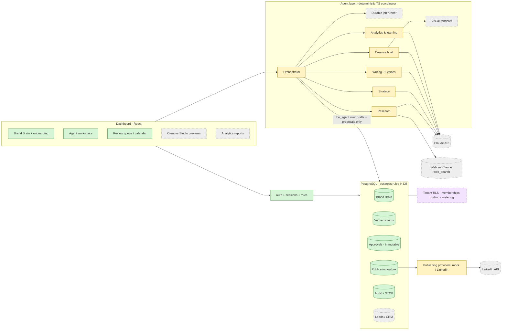
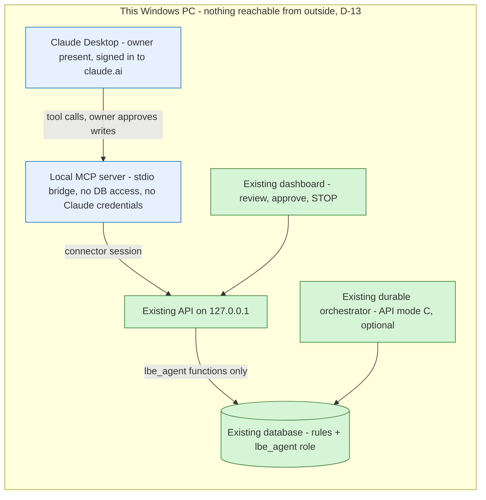

# plan.md — ActTrident AI LinkedIn Branding Agent

> **The single authoritative implementation and execution plan.** Read this (and `CLAUDE.md`) before any
> development. Architectural decisions live in [`docs/decisions/ADR-log.md`](docs/decisions/ADR-log.md); owner
> decisions in [`docs/owner-decisions.md`](docs/owner-decisions.md); owner to-dos in
> [`docs/owner-action-checklist.md`](docs/owner-action-checklist.md). If this plan and an ADR disagree, stop and
> reconcile them in both places before coding.
>
> Created 2026-11-19 from a full repository audit (commit `0989d12`). Task statuses:
> `NOT_STARTED` · `READY` · `IN_PROGRESS` · `BLOCKED` · `NEEDS_REVIEW` · `DONE` · `DEFERRED`.

---

## J. Progress dashboard (keep this section current)

| Item | Value |
|---|---|
| Current phase | **Phase 5 engineering complete; Phase 9 for this PC done** (P9-01, P9-03, P9-04, P9-05 DONE 2026-11-20; P9-02 deferred until remote access) (Phases 0–1, 4 (incl. P4-05), 5 DONE; Phase 2 engineering done — real content = owner OA-3; Phase 3 waits on OA-3/OA-6; Phase 6 waits on OA-2/OA-4) |
| Active task | P11-01a read-only connector — **verified with a real Claude Code session on this PC (2026-11-20 11:51: 10 entries, audited; no file or shell tools)**; owner chose Claude Code in the browser (Remote Control) — waiting for the Team-plan organization toggle ∥ P6-01 founder LinkedIn app — clipboard helper window open (owner clicks LinkedIn's copy buttons) |
| Next READY tasks | **Owner (clicks only):** claude.ai → Admin settings → Claude Code → Remote Control on, then chat at claude.ai/code; LinkedIn copy buttons for Client ID + Secret; later Connect LinkedIn + LinkedIn sign-in. **Claude, automatically:** pre-flight (server stopped) → start → owner connects → read-only `pilot:verify`. **Then:** P11-01b research tool (D-15 research). Live posting stays off |
| First safe milestone | **M1 Technical prototype hardened — REACHED 2026-11-19** (P1-01..06, P2-01/02; gate §H met: all suites green, restore proven, no open critical/high) |
| Completed this session | P0-01 … P0-06 (audit, baseline, plan, CLAUDE.md rule, owner checklist) · P1-01 backups · P1-02 sessions · P1-03 users · P1-04 logging · P1-05 security sign-off · P1-06 password change · P2-01 pillars · P2-02 onboarding wizard · P4-01 durable jobs · P4-02 checkpointed resume · P4-03 retry & step time limits · P4-04 run history · P5-00 render dependency gate · P5-01 render service · P5-02 brand templates & previews · P5-03 visuals in approval · P5-06 accessibility · P5-04 history · P5-05 monthly campaigns · P3-01 pricing verified · P3-03 prompt review · P3-02 realistic mock drafts · P2-04 account names · P2-03 document upload (txt/md) · P4-05 pipelined drafting · P2-03b PDF upload (2026-11-20, after OA-10) · P0-07 backup to a separate device (2026-11-20, D-13) · P9-04 automatic backups + Backups page · P9-01 local operations guide · P9-05 System health + incident runbook · P2-05 brain:reset-dev · P9-03 secrets/TLS/environment separation · P5-07 branded dashboard |
| Blocked (owner) | **OA-11 turn on BitLocker (C: found unencrypted)** · P2-08 real Brand Brain content · P3-04 paid evaluation · P6-01 founder LinkedIn app · P6-07 company app · OA-1 first backup copy to a USB drive (tool ready: `npm run backup:external`) |
| Owner actions required | See `docs/owner-action-checklist.md` (OA-1 … OA-9 and OA-11 open; OA-10 done 2026-11-20) |
| Latest passing tests | 2026-11-20: typecheck ✅ · Vitest 503 ✅ (11 PG skipped there) · `test:pg:embedded` 11/11 ✅ · Playwright 21 ✅ (incl. axe a11y) · secret scan ✅ · npm audit 0 ✅ · signatures verified ✅ |
| Latest commit | see `git log -1` |
| Next milestone | **M3 Internal MVP — engineering gate met** (durable jobs with kill/resume test, real visuals approved with posts, monthly campaigns); remaining M3 criterion is a person: **the owner completes one campaign end-to-end in the dashboard** (needs OA-2 user; best with OA-3 Brand Brain + brand colours). ∥ **M2 AI intelligence evaluation** (blocked on OA-3 + OA-6) |

No completion percentage is reported (no agreed weighting method).

---

## A. Product vision

A **standalone AI LinkedIn Branding Agent** — an AI branding team in one product, run by a non-technical owner.
It keeps a persistent, owner-approved **Brand Brain**; researches the market with verifiable sources; plans
campaigns; writes company-page and founder content in distinct voices; produces branded visuals and PDF
documents; routes every external action through **human approval**; publishes via **authorized LinkedIn
integrations**; reports permitted performance; and proposes improvements — never inventing facts or silently
rewriting the brand. Later it supports an **inbound-first** lead journey using first-party data only.

**Strategy (ADR-001, confirmed by owner 2026-11-19): internal ActTrident launch first (Customer Zero),
commercial multi-tenant SaaS later.** Keep SaaS boundaries (organizations, isolation, budgets) but do not build
billing, customer onboarding or enterprise features until Phase 10. Not related to the old `ai-social-media-team`.

---

## B. Current state (verified 2026-11-19, commit `0989d12`)

| Area | State | Evidence |
|---|---|---|
| Auth & sessions (in-DB, bcrypt, hashed tokens, lockout, CSRF origin check) | **Implemented & verified** | `tests/db/access-control`, `tests/integration/tenant-isolation` |
| Organization isolation (48 API routes, all definer functions) | **Verified for internal MVP**; RLS second layer missing (SaaS blocker) | ADR-023, `tenant-isolation` 15 tests |
| Approval binding, outbox, STOP (platform/org/account), audit | **Implemented & verified** incl. real-PostgreSQL concurrency | 87 DB tests, `npm run test:pg:embedded` 9/9 |
| Privileges (api/worker/agent roles) | **Verified**, snapshot test | `tests/db/function-security` |
| Migrations (forward-only, atomic, checksummed, upgrade-tested) | **Verified** | `tests/db/migration-upgrade`, `docs/migrations-runbook.md` |
| Brand Brain (13 sections, versioned, proposals, onboarding UI) | **Implemented & tested**; content: dev = synthetic, staging = empty | `brand-agent` 23 tests, `npm run brain:audit` |
| Agent workflow (research → strategy → 2 voices → visual briefs → checks → review) | **Mock-tested only**; Claude adapters type-checked, never called live | `brand-agent`, `agent-readiness`, eval runs NOT_READY (mock) |
| Evidence integrity (sources from tool, contradictions, restatement check, staleness, injection flags) | **Implemented & tested** (fake clients) | ADR-025 |
| Cost tracking & hard budget | **Implemented**; web-search price unverified | ADR-026 |
| Evaluation harness (isolated, gated paid runs, scoring sheet) | **Implemented** (mock runs only) | `docs/evaluation-plan.md` |
| Workflow execution | **Synchronous in HTTP request** — unsuitable for real models from the dashboard | hardening report §6 |
| Visual assets (images/PDF) | **Missing** (briefs only) | — |
| LinkedIn OAuth + live provider | **Contract-tested against a fake only; switched off** | `live-flow`, `linkedin-provider` |
| LinkedIn pilot (Stage 2.2) | **Prepared; blocked on owner** (app, users) | `npm run pilot:preflight` |
| Analytics & learning | Learning proposals from review decisions **implemented**; LinkedIn metrics **missing** | — |
| Lead intelligence | **Missing** (deferred to Phase 8) | — |
| Deployment / hosting / monitoring / backups | **Missing** (local only; no code remote, no DB backup tooling) | audit |

Environment: Windows 11, Node 26.13.1, Git 2.56, PGlite (dev/test), embedded PostgreSQL 18.6 (concurrency tests),
Docker Desktop installed but unusable (no WSL2 — not needed now). External dependencies not yet available:
Anthropic API key, LinkedIn developer apps, hosting.

---

## C. Architecture

Legend: green = implemented & verified · yellow = implemented, mock/fake-tested only · grey dashed = proposed ·
purple = SaaS (Phase 10). Key decisions: ADR-002 (replaceable orchestration), ADR-005/021 (DB-enforced gates,
agent role), ADR-014 (live gate, manual release), ADR-018 (Brand Brain), ADR-020 (Messages API + coordinator),
ADR-022 (STOP levels), ADR-023 (isolation status).

---

## D. Gap analysis

| # | Capability | Current | Desired | Why | Depends on | Size | Security | Acceptance |
|---|---|---|---|---|---|---|---|---|
| G1 | Data backup & restore | None; code has no remote | One-command DB backup + tested restore; code and data copied to a separate device (D-13) | Real Brand Brain data is about to be entered | — / OA-1 | S | Backups contain business data; keep git-ignored/encrypted | Restore test passes; runbook |
| G2 | Single source for pillars | `social_accounts.pillars` (SQL only) + Brain `pillars_goals` text | Owner edits pillars per account in Brand Brain UI; Brain section holds goals narrative only | No duplicate truth; owner can't edit pillars today | — | S | Admin-only, audited | UI + DB function + tests |
| G3 | Session hardening | 12 h absolute, no idle timeout, no "sign out everywhere" | Idle timeout, revoke-all, admin user management | Internal real users | — | S | Core auth | Tests |
| G4 | Real AI validation | Mock only | Paid evaluation scored by humans | Quality unknown | OA-3, OA-6, P3-01 | M | Budget, key handling | Scoring sheet complete |
| G5 | Durable jobs | Synchronous request | Persisted jobs, progress, cancel, retry, restart recovery | Real runs take minutes | — | M | Job runner uses lbe_agent role | Kill/restart test |
| G6 | Visual assets | Briefs only | Branded PNG + PDF document carousels from templates | Complete content package | P5 templates | M | No remote fetch in renderer (SSRF) | Rendered assets attached to drafts |
| G7 | Content operations | Single draft per account; basic calendar | Revisions, monthly plan, campaign objectives | Usable workflow | G5 | M | — | E2E |
| G8 | LinkedIn live | Fake-only | One approved founder post live; company page later | Core value | OA-2, OA-4, OA-5 | M | Tokens, permissions | Pilot log signed |
| G9 | Analytics | None | Permitted aggregate metrics, weekly report | Learning loop | G8 + CM access | M | Member-data rules | Weekly report |
| G10 | Leads | None | Inbound lead capture → attribution | Business outcome | G8, privacy docs | L | UK GDPR/PECR | E2E lead journey |
| G11 | Production deployment | Local only | Hosted internal production with monitoring | Repeatable use without Claude session | OA-9 | L | Secrets, TLS, backups | Ops runbook + acceptance test |
| G12 | Tenant RLS & memberships | API filters + definer checks | RLS second layer, memberships | SaaS | Phase 10 | L | Core isolation | Multi-tenant security tests |

---

## E. Implementation phases & milestones

| Phase | Goal | Exit condition | Milestone |
|---|---|---|---|
| 0 | Baseline & plan | Evidence-backed baseline + this plan | — |
| 1 | Security & engineering foundation | Current-scope critical/high resolved or listed as launch blockers; backups proven | **M1 Technical prototype hardened** |
| 2 | Real Brand Brain | Structurally complete, onboarding tested, owner able to enter/approve; real content may remain an owner blocker | M1 |
| 3 | Real AI intelligence validation | Paid run scored by humans (accuracy + voice) | **M2 AI intelligence evaluation** |
| 4 | Reliable orchestration | Start → monitor → recover → review, no duplicates/lost state | **M3 Internal MVP** (with 5) |
| 5 | Content production & Creative Studio | Approval-ready package incl. real visuals | M3 |
| 6 | LinkedIn connection & safe publishing | One approved post published with confirmation, audit, recovery | **M4 Internal pilot** |
| 7 | Analytics & learning | Weekly evidence-backed report + approved learning | M4/M5 |
| 8 | Inbound lead intelligence | Content link → first-party capture → attributed outcome | post-M5 (separately scoped) |
| 9 | Internal production readiness | Repeatable operational product | **M5 Production internal launch** |
| 10 | Commercial SaaS | Explicit SaaS readiness review passed | **M6 SaaS readiness** |
| 11 | Chat-First connector (MCP) — internal pilot, PROPOSED | Owner-present Claude Desktop flow saves drafts into review; mock publishing; zero API spend | (pilot, after D-14) |

Dependency order: 0 → 1 → 2 → (3 ∥ 4) → 5 → 6 → 7 → 9; 8 after 6 (+privacy); 10 after 9. Phases 3 and 4 can
proceed in parallel because the evaluation harness runs from the CLI, not the dashboard.

---

## F. Task register

Responsible: **C** = Claude (developer) · **O** = Owner · **X** = external approval (LinkedIn, legal, vendor).

### Phase 0 — Baseline & plan
| ID | Task | Deps | Pri | Status | Who | Files | Acceptance | Evidence |
|---|---|---|---|---|---|---|---|---|
| P0-01 | Audit repo, docs, git, tests | — | P0 | DONE | C | — | Baseline table §B | Audit 2026-11-19 |
| P0-02 | Re-verify all suites incl. PG concurrency | — | P0 | DONE | C | — | All green | §J latest tests |
| P0-03 | Create `plan.md` | P0-01 | P0 | DONE | C | plan.md | Sections A–K | this file |
| P0-04 | Add plan rule to `CLAUDE.md` | P0-03 | P0 | DONE | C | CLAUDE.md | Rule present | commit |
| P0-05 | Create `docs/owner-action-checklist.md` | P0-03 | P0 | DONE | C | docs/ | OA-1…9 with steps | commit |
| P0-06 | Reconcile ADRs with internal-first/SaaS-later; mark superseded docs | P0-03 | P1 | DONE | C | ADR-log, owner-decisions | ADR-027 recorded; D-04 answered | commit |
| P0-07 | Off-machine backup — **rescoped 2026-11-20 (owner: code and data stay on this PC, no cloud repository)**: one command copies the code (full Git history) and the databases to a **separate physical device** (USB drive) and proves the copy restores | — | P0 | DONE 2026-11-20 (tool); first copy = OA-1 | C (+O: plug in a drive) | services/api/src/external-backup.ts, cli/backup-external.ts | Refuses same physical disk and running servers; copy verified by restoring it; secrets not copied | **Evidence 2026-11-20:** `npm run backup:external -- --to E:\LBE-backups` writes a dated folder: `code.bundle` (all refs, full history), `databases/` (each embedded DB in `.env`/`.env.staging`, P1-01 format), `backup-set.json` (SHA-256 per file), `READ-ME-restore.txt`. It then **proves the copy restores** (clone → same latest commit; every DB restored with matching migrations and row counts) and fails loudly otherwise. `npm run backup:verify -- --set <folder>` re-checks checksums and restores again. Refuses: same physical disk (Windows `Get-Partition` disk number; **this laptop's C: and D: are both disk 0**, so D: is refused, confirmed by a real run), a folder inside the project, a running server; `--same-disk-ok` overrides (warning: deletion protection only). Secrets (`.env*`, `secrets/`) never copied; uncommitted changes warned. Tests: `tests/integration/external-backup.test.ts` 7/7 (full set + restore + no secrets; untouched passes / damaged caught; same-disk / inside-project refusals and override; damaged-while-writing reported as failure; running server refused; uncommitted warning; disk detection). Mutation checks: removing the same-disk refusal, the running-server refusal or the restore proof, or bundling only recent history, each fails ≥ 1 test. Real run on this project (to a temporary folder with `--same-disk-ok`, then deleted): 47 commits, development DB 231 rows, staging DB 13 rows, restored and matched; `backup:verify` passed. **Remaining (owner, OA-1):** first copy to a real USB drive. |

### Phase 1 — Security & engineering foundation
| ID | Task | Deps | Pri | Status | Who | Files | Acceptance | Verification |
|---|---|---|---|---|---|---|---|---|
| P1-01 | **DB backup & tested restore** (`db:backup`, `db:restore`; PGlite now, `pg_dump` documented for PostgreSQL URLs). **Evidence 2026-11-19:** `tests/db/backup-restore.test.ts` 5/5; staging backup + verified restore (6 migrations, 13 rows); refusals verified (server running, non-empty target, outside `.data/`) | — | P0 | DONE | C | scripts/, services/api/src/cli, docs/migrations-runbook.md | Backup of dev & staging; restore into new dir reproduces row counts & checksums; refuses to overwrite a running/live DB | `tests/db/backup-restore.test.ts`, manual run |
| P1-02 | Session hardening: idle timeout (60 min, DB-enforced in `require_user`/`whoami`), sign-out-everywhere (`lbe.logout_all`, `POST /api/auth/logout-all`, dashboard button + "session ended" notice). **Evidence 2026-11-19:** `tests/db/sessions.test.ts` 7/7 (mutation: removing idle check → 1 failure); api-flow +2; e2e +1 (7/7); privilege snapshot updated; PG concurrency 9/9 | — | P1 | DONE | C | migration 0700, app.ts, web | Idle sessions rejected; revoke-all works; tests | `tests/db/sessions.test.ts` |
| P1-03 | Admin user management UI (create/disable users, role change, approver assignment, end user's sessions, temporary-password reset; disabling/reset revokes sessions; no self-demotion; org-scoped) — no emails. **Evidence 2026-11-19:** migration 0800; `tests/db/user-management.test.ts` 13/13 (mutations: removing org check → 1 failure, removing self-change rule → 1 failure); api-flow +1; e2e +1 (8/8); privilege snapshot updated; PG 9/9 | P1-02 | P1 | DONE | C | migration, app.ts, web | Admin-only; audited; org-scoped; tests | integration test |
| P1-04 | Structured error logging & request IDs (no secrets/PII in logs): server-generated `X-Request-Id`; JSON access log (method, route pattern, status, ms, user id — never URL query, bodies, cookies, emails); 5xx → generic message + `request_id`; `redactForLog` on all error logs (API, OAuth, publisher). **Evidence 2026-11-19:** `tests/unit/redact.test.ts` 5/5, `tests/integration/logging.test.ts` 3/3 (mutation: logging the raw error → 1 failure); Vitest 312, e2e 8/8, PG 9/9 | — | P2 | DONE | C | app.ts | Every 5xx logged with request id; secret-leak test still passes | test |
| P1-05 | Security review sign-off for internal MVP; list SaaS blockers. **Evidence 2026-11-19:** `docs/hardening-report.md` §2a — signed off for internal use; finding F-1 (admin self-assigning as founder approver) fixed in migration 0900 + test; F-2 → P1-06; launch blockers per milestone listed; Vitest 313, PG 9/9, e2e 8/8, audit 0 | P1-01..04 | P1 | DONE |
| P1-06 | Self-service password change + "must change temporary password" on first sign-in (finding F-2). **Evidence 2026-11-19:** migration 1000 (`change_password`, `require_user_core`, LBE12 → 403); `tests/db/password-change.test.ts` 7/7 (mutation: removing the enforcement → 2 failures); e2e +1 (9/9); Vitest 320; PG 9/9 | P1-03 | P1 | DONE | C | migration, app.ts, web | Old password required; sessions other than current ended; temp-password users forced to change before anything else; tests | DB + e2e tests | C | docs/hardening-report.md | Findings table updated | doc |

### Phase 2 — Real Brand Brain
| ID | Task | Deps | Pri | Status | Who | Files | Acceptance | Verification |
|---|---|---|---|---|---|---|---|---|
| P2-01 | **Pillars single source**: owner edits account pillars in Brand Brain UI (DB function, audit); `pillars_goals` = goals narrative. **Evidence 2026-11-19:** migration 1100 `set_account_pillars` (admin, org-scoped, 1–8 slugs, dedupe, audited); `tests/db/account-pillars.test.ts` 5/5 (mutation: allowing non-admins → 1 failure); `brand-agent` +2 (workflow strategy + drafts use edited pillars; old content untouched; new content must use approved pillar); e2e +1 (10/10); mock strategist now picks from approved pillars | — | P1 | DONE | C | migration, app.ts, agentPages.tsx | Admin edit; existing content unaffected; agents use updated pillars; tests | integration test |
| P2-02 | Onboarding wizard: step-by-step order, progress, "UNKNOWN is OK" guidance, claims step linking to Claims register. **Evidence 2026-11-19:** `#/brain/onboarding` (14 steps from `ONBOARDING_STEPS`, resume at first missing, skip = UNKNOWN, pillars step, inline draft-claim step, review); `tests/unit/onboarding-steps` 2/2; e2e +1 (answer, skip, resume, claim, review, editor refused) 11/11; Vitest 329; PG 9/9 | P2-01 | P1 | DONE | C | web | Beginner can complete without docs; e2e test | Playwright |
| P2-03 | Document import improvements: file upload (txt/md/pdf→text) for proposals | P2-02 | P2 | DONE 2026-11-19 (txt/md; PDF → P2-03b) | C | app.ts, web | Grounded proposals only; size limits; tests | **Evidence:** `services/api/src/documents.ts` + `POST /api/brain/extract-text` (raw bytes; editor/approver/admin like ingest; no storage, no AI call, file name not logged). Strict decoding (UTF-8/BOM, UTF-16 BOM, Windows-1252 fallback with warning), NUL → refused as binary, control/invisible characters removed, safe base name; limits 256 KB (API body limit) and 50,000 characters (ingest limit), cut at a paragraph boundary with a visible warning. The dashboard's *Add knowledge from a document* panel now has a file picker: the text is shown for review in the paste box **before** *Create proposals* (labels now properly associated). The message now says how many suggestions were dropped as ungrounded. Grounding is unchanged and enforced: every proposal quotes the uploaded text word for word (tested end to end). PDF returns a clear "not switched on yet — paste or .txt" message. Tests: 9 unit (`tests/unit/documents.test.ts`), 3 integration (upload → review → ingest with quotes found in the file; PDF/docx/binary refused; 413 / 401 / cross-origin 403), 1 Playwright. ADR-032. |
| P2-03b | PDF text extraction for document upload (`unpdf` 2.1.0, isolated reader, bytes only, ≤ 5 MB / 50 pages; ADR-032 conditions 1–5) | P2-03, **OA-10** (approved 2026-11-20) | P3 | DONE 2026-11-20 | C | documents.ts, pdf-text.ts, pdf-child.ts, pdf-sandbox.ts, app.ts, web | PDF text appears for review; no network; limits tested | **Evidence:** `unpdf` 2.1.0 installed exactly (`--ignore-scripts`; lockfile integrity = reviewed tarball; no native binaries; audit 0; signatures verified). **Isolation changed from the planned worker thread to a separate process** after the worker version's memory test crashed the whole test process (V8 aborts the process when a worker runs out of memory). The reader (`pdf-child.ts`) runs under the Node permission model: it can read only its own code and the PDF library; no network, writes, child processes, threads or eval. It also has a 256 MB heap, a 15 s kill, none of the API's environment, output discarded, and at most 2 at once (third → 429). JS guards (`pdf-sandbox.ts`) refuse and log any network/file call as `pdf_reader_blocked`. Limits: 5 MB route-specific body limit (all other routes stay 256 KB; text files 256 KB), `%PDF-` header, ≤ 50 pages, encrypted PDFs refused (password or copy-restricted), scans → "paste instead", damaged → clear message. The text is shown for review with a "PDF text can have broken lines" warning, then goes through the normal grounded ingest. Dashboard: file picker accepts PDF, shows page count. Tests: 12 unit (`tests/unit/pdf-documents.test.ts`: text and £ decoding, 2 pages in order, not-a-PDF/empty/5 MB+1, both encryption kinds, 50 ok / 51 refused, scan, damaged, timeout kill, out-of-memory contained (test process survives), concurrency 2 → busy, links/open-action/remote file → no access attempt, permission-model probe with the reader's exact options (9 kinds of access all refused; no app environment), guard probe (10 kinds blocked and recorded)); 3 integration (PDF → review → proposals quote the PDF word for word; fake/locked PDF, docx, binary → 422; 300 KB .txt → 422, 5 MB+1 → 413, other route 300 KB → 413, signed out 401, cross-origin 403); 1 Playwright (.md and PDF upload, page count, warning; scan message). Mutation checks: removing the encryption refusal, page limit, `--permission`, eval ban, concurrency limit or env isolation each fails ≥ 1 test; removing the JS guards is not detected (the permission model, which is tested, already refuses everything; noted in ADR). `THIRD_PARTY_NOTICES.md` updated. ADR-032 amendment (incl. residual risk: memory outside the JS heap during a 15 s read). |
| P2-04 | Account display names / founder name editable (admin) | P2-01 | P2 | DONE 2026-11-19 | C | migration, web | Audited; tests | **Evidence:** migration `20261119002100_account_names.sql`: `lbe.set_account_display_name` (admin only, own organization, audited as `account.renamed` with from/to; no audit when unchanged) + trigger on insert / change of `display_name` (1–120 chars trimmed; no line breaks, control characters or `<>`, because the name goes into the writer's prompt). The trigger fires only when the name changes, so an unrelated update of an older row (e.g. credential revoke forcing mock mode) can never be blocked. Name is **not** in the publication package → renaming leaves approvals intact (tested: package hash and `approved` status unchanged). API `PUT /api/accounts/:id/name`; dashboard: *Rename* on **Accounts & voices** (admin only) and an **Account names** panel in the guided-setup step, now "Account names & pillars". Tests: 8 DB (`tests/db/account-names.test.ts`: admin-only, cross-org 404, validation incl. prompt-delimiter and newline injection, direct writes checked, unrelated updates not blocked, approval unaffected, agent/worker roles refused) + 1 integration (non-admin 403, bad name 422, cross-tenant 404, the new name reaches the writer for new drafts) + 1 Playwright (rename, guided setup shows it, restore, editor sees no *Rename*); function-security list updated. Owner checklist OA-3 now tells the owner to set real names. |
| P2-05 | Retire synthetic dev knowledge path: `brain:reset-dev` (dev only) — fresh development database with the dev logins and accounts but no synthetic claims (old database moved aside, never deleted); `--with-synthetic-claims` brings the examples back | — | P3 | DONE 2026-11-20 | C | cli | Refuses on staging | **Evidence:** `services/api/src/dev-reset.ts` + `npm run brain:reset-dev`; `seed()` split into `seedUsersAndAccounts` + `seedSyntheticClaims` (seed unchanged for tests). Refuses: `LBE_ENV` not development, `LBE_ENV_FILE` other than `.env`, a data folder that is (or looks like) staging's, PostgreSQL, a folder outside `.data`, a running dev server, missing dev passwords. Old database renamed `<folder>-before-reset-<time>`, never deleted. Tests: `tests/integration/brain-reset-dev.test.ts` 3/3 (fresh DB = 4 logins, 2 accounts, 0 claims, 0 Brand Brain entries; old DB intact with its 4 claims; staging marker untouched; dev login works; `--with-synthetic-claims` → 4; 7 refusals with nothing moved). Mutations (staging env allowed, staging folder allowed, running server ignored, claims always seeded) each caught. Real refusals on this PC (server running; `LBE_ENV_FILE=.env.staging`) verified; the owner's dev database was **not** reset. Guide: `docs/local-operations.md` → Practising first. Vitest 476 |
| P2-06 | Staging bootstrap for real use (`staging:init` + admin user) | — | P1 | DONE 2026-11-20 | O+C | scripts/create-staging-admin.ps1 | Pre-flight passes user checks | **Evidence:** staging backed up first (`backups/lbe-staging-2026-11-20T06-57-37-171Z`, 13 rows), migrated 6 → 21 (forward-only), accounts present (company page, founder profile). The owner's admin login was created in a window Claude opened (`scripts/create-staging-admin.ps1`: name, email, password typed hidden twice, ≥ 12 characters, password only in memory for the one command; approver for both accounts). Staging started (https://localhost:8443, environment badge "Staging · real data"); first automatic backup OK (17 rows, drill passed). OA-2 done |
| P2-07 | Import brand/voice files decision (keep or replace placeholders) | — | P3 | DONE | C | — | Placeholder files flagged by audit | ADR-018 |
| P2-08 | **Owner enters real Brand Brain + 3–5 verified claims** in staging | P2-06 | P0 | BLOCKED | O | — | `brain:audit:staging` shows no UNKNOWN required / no synthetic | OA-3 |

### Phase 3 — Real AI intelligence validation
| ID | Task | Deps | Pri | Status | Who | Files | Acceptance | Verification |
|---|---|---|---|---|---|---|---|---|
| P3-01 | Verify official pricing (incl. web search) & model availability; update `cost.ts` | — | P1 | DONE | C | services/agents/src/cost.ts, ADR-026 | Prices cited with URL+date; tests updated | **Evidence 2026-11-19:** official pricing + models pages fetched; Opus 5.5 $4/$20, Sonnet 5.5 $2/$10, Fable 5.2 $8/$40 confirmed; web search $10/1k confirmed (results billed as input) → "unverified" removed; **2 budget gaps found & fixed:** Haiku 5.5 is tiered (now priced at the >100k tier) and cyber-category refusals fall back to Opus 4.8 ($5/$25) → adapters report `servedBy`, fallback priced as dearer×2 upper bound; `fallbacks: "default"` + `server-side-fallback-2026-07-01` confirmed valid; opus-5-5 retirement not before 2027-09-22; unit +4 (price table, Haiku tier, fallback pricing, every default model priced); evaluation plan: rough cost guide (≈$1–2/weekly run) + hidden key prompt (was in shell history); Vitest 399 |
| P3-02 | Make mock drafter produce length-compliant posts (so mock evals test the pipeline, not template length) | — | P3 | DONE 2026-11-19 | C | mock-drafter | Mock eval no longer fails on length only | **Evidence:** mock drafter rewritten (offline, deterministic): 130–240-word posts; opening avoids the plan's `otherOpenings`; per-post shuffle over larger phrase pools so posts don't read as one template; no digits or claim-like wording; "we"/"I" voice per account; Title-Case topics lower-cased mid-sentence. Mock eval on 3 goals (default phishing; "Password hygiene for small teams"; "Supplier security reviews for UK firms"): length 8/8, unsupported 0/8, voice warnings 0, max overlap 0.15 / 0.21 / 0.15 (≤ 0.25), repeated openings 0 — all pass. Remaining eval fails are expected for a mock run only (mock sources, synthetic Brand Brain, mock provider). +4 unit tests (`tests/unit/drafting.test.ts`: length, claim/voice/hashtag checks, overlap ≤ 0.25, opening avoidance + determinism). Mock text tests the pipeline only — it says nothing about real content quality (that is P3-04/P3-05). |
| P3-03 | Prompt review for real models (ICP-aware strategy, originality instructions, length) | P3-01 | P2 | DONE | C | prompts, `docs/prompt-review.md` | Reviewed against Brand Brain sections | **Evidence 2026-11-19:** `docs/prompt-review.md` (audit method from the Claude API reference; 8 findings, keep-list, no dated patterns found); writer v3 (ICP paragraph, originality + reasons, `otherOpenings` data block fed by the orchestrator), strategy v2 (ICP problem + campaign objective/focus, distinct angles), creative v2 (alt text matching the DB rule, format guidance, cover + 9 slides matching the renderer); unit +2, integration +1 (openings passed); Vitest 402, e2e 17/17. **Not yet measured with a real model** → P3-04/P3-05 |
| P3-04 | **Paid evaluation run** (budget-capped) from staging snapshot | P2-08, P3-01, OA-6 | P0 | BLOCKED | O+C | eval-results/ | Run completes within budget | `eval:campaign --provider anthropic` |
| P3-05 | Human scoring of P3-04 output | P3-04 | P0 | BLOCKED | O | scoring-sheet.md | Accuracy & voice scored | sheet |
| P3-06 | Tune prompts/validators from scores; re-run (budgeted) | P3-05 | P1 | NOT_STARTED | C | agents | Scores improve or issues documented | eval |

### Phase 4 — Reliable orchestration
| ID | Task | Deps | Pri | Status | Who | Files | Acceptance | Verification |
|---|---|---|---|---|---|---|---|---|
| P4-01 | Durable job table + runner (claim/lease like outbox, lbe_agent role) | — | P1 | DONE | C | migration 1200, `jobs/agent-runner.ts`, orchestrator `onProgress`, api, web job page | Jobs persisted; one runner claims; lease expiry detected → job `interrupted` (safe, no duplicate re-run; true resume = P4-02) | **Evidence 2026-11-19:** `tests/db/agent-jobs` 9/9; `tests/integration/agent-jobs` 4/4 (202 + background run, cancel stops before next model call, redacted failure, job session refused by API); `brand-agent` rewired through the runner; PG 10/10 incl. claim race (mutation: no row lock → fails 3/3); e2e 11/11; live dev-server demo: queued → succeeded; ADR-028 |
| P4-02 | Step checkpoints & safe partial results (resume an `interrupted` job without duplicate drafts). **Evidence 2026-11-19:** migration 1300 (unique draft per workflow/plan item/account; auto-requeue ≤3 attempts; `job_resume`; claim returns workflow + prior spend); orchestrator resume path (reuse findings/plan/drafts, deterministic `planItemGroup`, atomic create+link); integration "hung runner → B resumes → no duplicates, half-written draft continued, research not repeated, zombie cannot write" (mutation: random plan ids → fails); DB tests 11/11; PG 10/10 ×3; e2e 11/11; dev DB upgraded; dashboard "Resume where it stopped" | P4-01 | P1 | DONE | C | orchestrator | Kill mid-run → resume → no duplicates | integration test |
| P4-03 | ~~Cancel~~ (done in P4-01); retry of failed/cancelled jobs (interrupted → Resume, P4-02), per-step timeouts; per-run cost on job | P4-01 | P1 | DONE | C | migration 1400, orchestrator `withStepTimeout`, specialists/drafter `signal`, runner, api, web Retry button | Retry creates a linked job; step timeout fails cleanly | **Evidence 2026-11-19:** integration: stuck writer aborted at limit (signals aborted, drafts held with reason, run finishes); stuck strategy → job failed "strategy timed out" → Retry once → linked new run succeeds; DB retry rules; unit: SDK requests receive the abort signal; bug found & fixed (abort error used to win the race over the timeout message); Vitest 348, PG 10/10, e2e 11/11 |
| P4-04 | Dashboard progress view — job page (stage/progress/cancel/resume/retry) + "In progress" panel + **Run history** (status, requester, when, duration, drafts/in review, est. cost) + job summary; Users page counts only interactive sessions and shows running agent jobs. **Evidence 2026-11-19:** migration 1500; DB test (job session not counted); integration (history fields); e2e: run → history row "done 8 (8)" → summary → "Open the results" (11/11); Vitest 349; PG 10/10 | P4-01 | P2 | DONE | C | web | Progress & cost visible; e2e | Playwright |
| P4-05 | Safe parallelism (drafts per item) with budget awareness | P4-02 | P3 | DONE 2026-11-19 | C | orchestrator | Faster, same results; budget respected | **Evidence:** ADR-033 pipelined drafting. Writer calls stay sequential and in plan order (P3-03 openings unchanged); each draft's visual brief, render and review submission overlap with the next writer call (`parallelDrafts`, default 3, range 1–4). Budget decisions are identical to one-at-a-time: in-flight work reserves its worst-case cost (`worstCaseCallUsd`; `max_tokens` is now one shared constant), and decisions wait whenever that could matter. Every exit path waits for in-flight work. `draftOne` split into `writeDraft`/`finishDraft`. Tests: `tests/integration/parallel-drafting.test.ts` (6: identical drafts and writer inputs vs one-at-a-time; overlap seen, never two writers; 1,648 → 1,003 ms in simulation; paid-like budget near the limit and with headroom → same spend and decisions; cancel and error leave nothing running; worst-case bound) + `tests/db/concurrent-tx.test.ts` (2: PGlite isolates concurrent transactions and roles). Mutation check: budget guard removed → 1 fail, exit wait removed → 4 fail. All 101 existing integration tests pass with pipelining on; the mock campaign evaluation is unchanged (8/8, overlap 0.15, 0 repeated openings). |

### Phase 5 — Content production & Creative Studio
| ID | Task | Deps | Pri | Status | Who | Files | Acceptance | Verification |
|---|---|---|---|---|---|---|---|---|
| P5-00 | **Gate:** dependency review for Satori / resvg-js / pdfkit (licence, maintainers, native binaries, 14-day cooldown, install scripts) recorded in ADR dependency table | — | P1 | DONE | C | ADR-log | Approved versions pinned or alternative chosen | **Evidence 2026-11-19:** ADR-029 — satori 0.63.2, **@resvg/resvg-wasm** 2.6.2 (chosen over native resvg-js), pdfkit 0.20.2, @fontsource/inter 5.3.0, fflate override 0.7.5; isolated trial install (scratch, `--ignore-scripts`): 41 pkgs, 0 install scripts, licences MIT/MPL/Apache/ISC/OFL, 41/41 registry signatures, audit 0 after override (advisory shown unreachable: satori uses only `inflateSync`); 5 conditions for P5-01 (no-egress, data-URI only, Buffers only, notices, deterministic fonts) |
| P5-01 | Render service (Satori + resvg-wasm + pdfkit per ADR-029; must meet its 5 conditions). **Evidence 2026-11-19:** `services/render` (`@lbe/render`: validateCarousel, renderSlidePng, renderCarousel → PNGs + PDF, assertNoExternalResources); deps pinned + fflate override (audit 0, no new install scripts); `tests/unit/render.test.ts` 7/7 (1080×1350 PNG, deterministic bytes, one PDF page per slide, limits, refused logo sources, structural no-network guarantee; mutations of both guards → failures); visual check of `npm run render:demo` found & fixed an overflow bug (text off the right edge, page counter/footer missing); probe found Satori DNS-resolves image hosts → guarantee made structural (ADR-029 note); THIRD_PARTY_NOTICES updated; Vitest 356, PG 10/10, e2e 11/11 | P5-00 | P1 | DONE | C | services/render | No network egress; data-URI assets; tests | unit tests |
| P5-02 | Brand templates (single image, document carousel) from Brand Brain identity (placeholder identity until P2-08); map the agent's visual brief → slides; owner-editable brand colours/logo | P5-01 | P1 | DONE | | `services/render/src/templates.ts`, migration 1600, api `/brand/visual-identity` (+ `sample.png`), `/content/:id/visual`, web Visual identity panel + `VisualPreview` | | **Evidence 2026-11-19:** identity stored as owner-approved Brand Brain entry identity/visual (versioned, admin-only); brief→slides mapping with clipping (cover + ≤9 at 1080×1350; single 1080×1080); placeholder flagged (`x-placeholder-branding`); design flaw caught: colours would have falsely completed "Brand identity" → migration 1600 + wizard/audit fix (mutation → failure); unit 7, integration 4 (org isolation, admin-only, remote logo refused), e2e +1 (12/12); visual check of square template (removed "1 / 1" counter); Vitest 367, PG 10/10 | C | templates | Rendered PNG/PDF previews | snapshot tests |
| P5-03 | Attach assets to drafts (media ids in package → approval covers visuals) | P5-02 | P1 | DONE | C | migration 1700, api attach/remove/media, agent `attachVisual` hook, web AttachedVisual | Editing visual invalidates approval | **Evidence 2026-11-19:** ADR-030; `tests/db/media-assets` 7/7 (attach/replace/remove after approval → draft + enqueue refused; immutable even for owner; only same-post assets — mutation → failure; file-signature checks; org isolation; agent can attach not approve); integration +3 (placeholder → 409 & agent skips with warning; attach → exact bytes + sha header → approver's package contains media id; agent attaches before review); privilege snapshot caught PUBLIC-executable trigger functions → revoked; PL/pgSQL IF/CASE parse bug found & fixed; e2e 12/12; Vitest 376; PG 10/10 |
| P5-04 | Draft revisions & history view | P4-02 | P2 | DONE | C | migration 1900, api `/content/:id/history`, web HistoryPanel + `diff.ts` | Version diff visible | **Evidence 2026-11-19:** `lbe.content_revisions` written by trigger on every package change (immutable; actor + role, so agent edits are labelled; existing posts backfilled as their starting point); history lists decisions per version; `tests/db/content-revisions` 4/4 (mutation: record only on insert → failure); word diff `tests/unit/diff` 5/5 — e2e exposed a readability bug (replaced phrases split word-by-word) → fixed by folding whitespace into change blocks; e2e history + diff (16/16); Vitest 389; PG 10/10 |
| P5-05 | Monthly planning & campaign objectives | P4-04 | P2 | DONE | C | migration 2000, api `/agent/campaigns`, web planner + campaign page | Month plan without duplicates | **Evidence 2026-11-19:** ADR-031 — campaign = sequential weekly durable jobs (objective, pillar-rotating focus); `job_claim` enforces week order (DB test + real-PostgreSQL race: 8 runners → only week 1; mutation → failures in both); one active campaign per org, outside the ad-hoc limit; retries keep their week; honest "partially completed"; integration: 3 weeks × 3 posts via API + runner → 9 distinct topics, all pairwise similarity < 0.5, dates inside their week; e2e: plan 2 weeks in UI → completed → 12 posts, 6 distinct topics (17/17); mock strategist has 12 angles; Vitest 395, PG 11/11 |
| P5-06 | Accessibility (alt text required for visuals — editable by the reviewer; keyboard nav check; axe would be a new dev dependency → review first) | P5-03 | P2 | DONE | C | migration 1800, web, tests/e2e/a11y.spec.ts | axe checks pass | **Evidence 2026-11-19:** `alt_text_problem` blocks review without real alt text; `set_media_alt_text` → new immutable copy → re-approval; `tests/db/alt-text` 4/4; reviewer alt-text editor; agent drafts failing a DB rule are held, not failed; skip link + focus outline; `@axe-core/playwright` 4.14.0 reviewed (axe-core pinned 4.14.0, cooldown); a11y e2e 4/4 — keyboard-only path, 0 serious/critical WCAG A/AA violations on sign-in + 8 pages (mutation: image without alt → image-alt critical); Vitest 380, e2e 16/16 ×2, PG 10/10 |
| P5-07 | Dashboard look & feel with ActTrident branding (owner request 2026-11-20): official logo (from the company website, owner-approved use), brand-coloured theme, grouped navigation, environment badge (development vs staging), branded sign-in page and browser icon | P5-06 | P2 | DONE 2026-11-20 | C | apps/web | Accessibility unchanged (axe, keyboard); all e2e pass | **Evidence:** logo found via web search (only ActTrident site found: acttrident-site.pages.dev, header links to acttrident.ai; UK IPO journal confirms ACTTRIDENT LTD); original PNG verified (signature, 2048×1365, SHA-256 recorded in THIRD_PARTY_NOTICES), cropped to the shield and resized with Windows' built-in imaging (32/64/96/192 px, 3–90 KB). Colours sampled from the logo (navy #01040f, shield blue #046fc5 = 5.1:1 on white). Navy sidebar with logo, grouped menu (Create / Review & publish / Govern / Admin; link names unchanged; `aria-current`), environment badge from `/api/health` (`environment` added) incl. "LIVE LinkedIn publishing on" warning, branded sign-in page, favicon + title. Visual check by screenshots (sign-in background bug found and fixed). Playwright 21/21 incl. axe (no serious/critical) and keyboard test; Vitest 481 |

### Phase 6 — LinkedIn connection & safe publishing
| ID | Task | Deps | Pri | Status | Who | Files | Acceptance | Verification |
|---|---|---|---|---|---|---|---|---|
| P6-01 | Founder app created; secrets in `.env.staging` | — | P0 | IN PROGRESS 2026-11-20 (owner: "linkedin things are also ready"; guided window `scripts/set-linkedin-app.ps1` opened, secret typed hidden, never in chat) | O | — | Pre-flight passes | OA-4 |
| P6-02 | Pilot: test profile connect + read-only verify | P6-01, P2-06 | P0 | BLOCKED | O+C | pilot log | U1–U3, U6 recorded | `pilot:verify` |
| P6-03 | Pilot: one approved live post (owner present) | P6-02 | P0 | BLOCKED | O+C | pilot log | Post visible; URN stored; audit complete | pilot log |
| P6-04 | Media upload (images/documents) for live provider | P5-03, P6-03 | P2 | NOT_STARTED | C | publishing | Contract tests + pilot | tests |
| P6-05 | Token expiry reminders & reconnect UX | P6-02 | P2 | NOT_STARTED | C | web | Warnings at 14/3 days (exists) + reconnect flow verified live | pilot |
| P6-06 | Legal answer on scheduled release (§3.1(26)) | — | P1 | BLOCKED | O/X | — | Written answer | OA-7 |
| P6-07 | Company app + Community Management review | — | P1 | BLOCKED | O/X | — | Approved by LinkedIn | OA-5 |

### Phase 7 — Analytics & learning
| ID | Task | Deps | Pri | Status | Who | Acceptance |
|---|---|---|---|---|---|---|
| P7-01 | Aggregate post metrics ingest (company page via CM; founder if permitted) | P6-07 / U-checks | P1 | NOT_STARTED | C | Metrics stored ≤1 yr, aggregates only |
| P7-02 | Weekly branding report (facts vs hypotheses labelled) | P7-01 | P1 | NOT_STARTED | C | Report generated from stored data only |
| P7-03 | UTM links on posts + site analytics (Umami) | P8-01 | P2 | NOT_STARTED | C | Clicks attributed |
| P7-04 | Learning proposals from metrics (extends existing review-based learning) | P7-02 | P2 | NOT_STARTED | C | Evidence-linked proposals |

### Phase 8 — Inbound lead intelligence (separately scoped; after Phase 6)
| ID | Task | Deps | Status | Who |
|---|---|---|---|---|
| P8-01 | Privacy notice, LIA, retention policy | OA-8 | BLOCKED | O/X |
| P8-02 | Lead-magnet landing page + consented capture | P8-01 | NOT_STARTED | C |
| P8-03 | Leads/companies/consent/suppression schema + dedup | P8-02 | NOT_STARTED | C |
| P8-04 | Explainable fit/intent scoring (first-party evidence only) | P8-03 | NOT_STARTED | C |
| P8-05 | Follow-up drafts with approval + suppression trigger | P8-04 | NOT_STARTED | C |
| P8-06 | Meetings/opportunities + attribution | P8-03 | NOT_STARTED | C |

### Phase 9 — Internal production readiness
| ID | Task | Deps | Status | Who |
|---|---|---|---|---|
| P9-01 | Hosting decision (owner) & deployment architecture — owner direction D-13 (2026-11-20): this PC; local operations guide. **DONE 2026-11-20:** `docs/local-operations.md` (development vs staging, this-PC-only access, start/stop, both backup layers, restore incl. new PC, updates, 5-minute weekly routine). Remote access for colleagues = future decision (HTTPS for the PC name, firewall, P9-02) | OA-9 → D-13 | DONE | O+C |
| P9-02 | Real-user auth (SSO or MFA) — **DEFERRED 2026-11-20:** under D-13 the dashboard only answers on this PC (127.0.0.1), so the main threat MFA/SSO addresses (remote password guessing or phishing) cannot reach it; SSO also needs owner decision D-05. **Restart trigger:** any decision to allow access from other computers (then do MFA for admins/approvers first, with HTTPS for the PC name). Existing controls meanwhile: bcrypt, lockout, idle timeout, sign-out-everywhere, forced change of temporary passwords | P1-02, D-05, remote-access decision | DEFERRED | C |
| P9-03 | Secrets management, TLS, environment separation — for this PC (D-13): certificate expiry + renewal, disk encryption and secret-file access checks, start-up guard against shared databases, secrets inventory. **DONE 2026-11-20 (ADR-035):** System health + 3 checks: disk encryption (Windows BitLocker property, no admin), secret-file access (ACLs by well-known SID; Everyone/Authenticated Users/Users/Guests → problem), HTTPS certificate expiry (read at start from the server's own PFX; < 30 days → attention). `npm run staging:renew-cert` (keeps passphrase and old file; tested end to end in a scratch project, store left clean). `assertSeparateDatabase` refuses start-up when development and staging share a database folder. Secrets inventory + replacement steps in `docs/local-operations.md`. **Finding: drive C: is not encrypted → owner action OA-11 (high).** Tests: `system-health` +5 (14/14) incl. a real probe on this PC (secret files private; a temp file opened to Everyone detected). Mutations (BitLocker off = fine, open files ignored, Everyone missing from probe, expiring certificate unflagged, shared database allowed) each caught | P9-01 | DONE | C |
| P9-04 | Automated backups + restore drill (in-server daily backups while running, retention, restore drill per backup, USB copy without stopping the server, dashboard status + overdue reminder). **DONE 2026-11-20 (ADR-034):** `auto-backup.ts` — server snapshots its embedded DB (`Db.snapshot`: CHECKPOINT + `dumpDataDir` inside a transaction slot), restore-tests it in a separate process (`backup-drill-child.ts`), writes the P1-01 manifest only after the drill passes (failed → archive deleted, status "failed"), keeps newest 14, every 24 h (`LBE_AUTO_BACKUP_HOURS`/`_KEEP`). `backup:external` uses a running server's newest automatic backup (≤ 26 h) instead of refusing, records each separate-disk copy. Admin **Backups** page + `GET /api/admin/backups` (read-only): newest backup, last attempt, last USB copy, warnings (failed, stale, no/7-day-old USB copy). Tests: `auto-backup` 8/8, `external-backup` +2 (9/9), Playwright +1 and Backups in the a11y scan (20/20). Mutations (non-exclusive snapshot, failed drill keeping archive, schedule ignoring interval, page not admin-only, any-age auto backup, same-disk copy recorded) each caught. Real runs: server's first automatic backup 1 min after start (231 rows, drill passed); `backup:external` while running used it + fresh staging backup, verified. A test hang was found and fixed (the test's write loop starved the event loop; the server is not affected because each query is its own request) | P1-01, P9-01 | DONE | C |
| P9-05 | Monitoring, alerting, incident runbook (incl. LinkedIn 24 h incident rule) — for this PC (D-13): admin System health page + attention banner, incident runbook. **DONE 2026-11-20:** `system-health.ts` + `GET /api/admin/system` (admin, read-only): database answering (5 s limit), free disk space (warn < 5 GB, problem < 1 GB), backups (from P9-04), publishing worker and Branding Agent runner heartbeats (stale → "restart"; job > 1 h → attention; publisher off on the pilot server = information only), live publishing state, secret files tracked by Git (cached `git ls-files`), uptime; each check says what to do. Dashboard: **System health** page and an admin banner on every other page while anything needs attention ("alerting" for a single PC). `docs/incident-runbook.md`: LinkedIn API Terms §7.1(d) **verified at the source 2026-11-20** (report within 24 h in writing to security@linkedin.com; no public statement without permission); first moves (Stop all publishing, sign everyone out); lost/stolen PC, account compromise, wrong post, exposed key/secret, damaged database, ransomware, full disk — using only existing dashboard controls. Tests: `system-health` 9/9 (thresholds, stale/long-running workers, publisher-off = info, tracked secrets, dead DB, failed backup, real free-space and real-repo secret check, API 401/403/403/200), Playwright +1 and System health in the a11y scan (21/21). Mutations (page not admin-only, stale worker undetected, tracked secrets ignored, low disk not flagged) each caught | P9-01 | DONE | C |
| P9-09 | **One program per embedded database** (incident 2026-11-20: the pilot pre-flight opened the staging database while the server ran). Lock file next to the folder taken by every opener (server, CLIs, backup, restore); stale locks from crashed programs taken over; pre-flight and verify refuse politely. Staging restored from the backup taken 2 min before | — | P0 | DONE 2026-11-20 | C | `services/api/src/pglite-lock.ts`, `db.ts`, `backup.ts` | Second opener refused | `tests/integration/pglite-lock.test.ts` (6, incl. a real second process; mutation: removing the lock fails 4); staging pre-flight refused while running |
| P9-06 | Retention jobs, privacy docs, accessibility review | P8-01 | NOT_STARTED | C |
| P9-07 | Internal acceptance test with real approved content | all above | NOT_STARTED | O+C |
| P9-08 | Deployment approval | P9-07 | BLOCKED | O |

### Phase 10 — Commercial SaaS (DEFERRED until M5)
P10-01 org RLS second layer · P10-02 memberships · P10-03 customer onboarding · P10-04 per-tenant OAuth/apps ·
P10-05 billing & metering · P10-06 tenant AI budgets · P10-07 per-tenant key separation · P10-08 support admin ·
P10-09 tenant retention/deletion · P10-10 DPA/terms/sub-processors · P10-11 multi-tenant pen test ·
P10-12 licence re-verification. All **DEFERRED** (ADR-001, ADR-023 gaps 1–6).

### Phase 11 — Chat-First connector (MCP), internal pilot — PROPOSED, awaiting owner decision D-14
Goal: the owner researches, plans and writes **interactively in Claude Desktop** (existing subscription, owner
present). Results land in this system as **drafts and proposals** that go through the existing review, approval
and STOP controls. The automated API mode (Phases 3/4, design C) stays as it is. Evidence: `docs/chat-first-mcp-review.md`
(official sources, 2026-11-20). Decision record: ADR-036 (proposed).

| ID | Task | Deps | Pri | Status | Who | Acceptance |
|---|---|---|---|---|---|---|
| P11-00 | Research official Anthropic docs; inspect codebase; compare designs A/B/C; MCP tool design; recommendation | — | P2 | DONE 2026-11-20 | C | `docs/chat-first-mcp-review.md` with cited sources |
| P11-01 | **Owner decision D-14** (design A pilot or otherwise) and **D-16** (confirm Claude plan; business use is allowed under its terms; *Settings → Extensions/Developer* present in Claude Desktop). **2026-11-20: owner agrees with design A in principle; full connector NOT yet approved — read-only proof of concept first (P11-01a)** | P11-00 | P1 | PARTLY DONE | O | Decisions recorded |
| P11-00b | Recheck two findings against current official docs: local MCP per Claude surface (Desktop chat / Cowork / Desktop Extensions / Claude Code / claude.ai web) and the exact Consumer Terms clauses (commercial use vs automated access) | P11-00 | P1 | DONE 2026-11-20 | C | Review and ADR-036 corrected with quotes | **Evidence:** review §6. Desktop chat: supported (stated, code.claude.com/docs/en/desktop); Cowork: not stated; Desktop Extensions: packaging of local servers; Claude Code CLI: does not read the Desktop config; claude.ai web: remote only. Consumer Terms (effective 8 Oct 2025, UK consumer version): §11 non-commercial clause quoted with its scope; §3(7) automated-access clause quoted separately; the earlier blanket statement withdrawn (applicability to a company's Pro or Max account is a legal question, D-16) |
| P11-01a | **Read-only proof of concept:** one tool, `get_brand_brain`, through a restricted, authenticated local MCP bridge (connector session usable by exactly one database function; bridge has no DB access; API on 127.0.0.1; off by default); verify Claude Desktop chat can call it. No write tools until verified | P11-00b | P1 | VERIFIED WITH CLAUDE CODE 2026-11-20 (browser view pending the owner's Remote Control toggle) | C (+O: one chat test) | Claude Desktop chat returns approved entries; audit shows the call; privilege tests | **Evidence 2026-11-20 (review §7):** migration `20261120000100_connector_poc.sql` (connector key: admin-only, ≤ 8 h, revocable, audited; accepted by exactly one function, `lbe.connector_brain_get`, `lbe_agent` only; `session_resolve` tightened to name `agent_job`). API `GET /api/connector/v1/brand-brain` (Bearer only, `LBE_CONNECTOR=off` by default) + admin routes; dashboard panel on System health. Zero-dependency stdio bridge `services/api/src/connector-bridge.ts` (one read-only tool, key only to 127.0.0.1/localhost, HTTPS certificate pinning). Tests: DB 7, integration 9 (incl. the real bridge process over stdio), privilege snapshot; mutations (key accepted elsewhere, read function accepts any session, off switch ignored, key returned to browser, tool not read-only) each caught; Vitest 496, Playwright 21, PG 11/11, audit 0. Real runs: development (connector on) → bridge returned 10 approved entries, key never exposed, call audited; staging pinning with a dummy key → matching certificate reaches the server, wrong certificate sends nothing (two bugs found and fixed: pinned socket bypassed; timeout crashed the bridge). Claude Desktop (Store build 6.6395) config found at `%LOCALAPPDATA%\Claude-Data\claude_pzs8sxrjxfjjc\` (not the documented path), entry added beside existing preferences (backup kept), app restarted. **Blocker:** the chat call itself needs the owner at the screen; the app log showed "sessions not loaded" (likely waiting for the owner). **Next:** owner runs the chat test; if it passes, enable on staging (owner creates a staging key), then decide P11-02 (SDK gate) and write tools (D-15) | **2026-11-20 (2), owner switched to Claude Code in the browser (Remote Control; review §8):** a real Claude Code 2.1.329 session in the locked-down chat folder (`scripts/start-brand-chat.ps1`: only get_brand_brain + web research; shell, files, personal connectors denied) called `get_brand_brain` → 10 entries; Read/Bash absent from its tools; audit `connector.tool_called` 11:51:05. Team plan detected (`claude auth status`). **Blocker:** Remote Control "disabled by your organization's policy" until the owner switches it on |
| P11-01b | **Research from Claude chat** (owner request 2026-11-20: "do setup and all for claude chat for the research", recorded as D-15 for research): one write tool, `save_research_findings`, through the same connector key. Findings land in the existing `research_findings` table flagged `via_claude_chat` + `unverified` with source URL and date; they never change the Brand Brain, never become claims, and need owner review. Same refusal tests as P11-01a (approve, publish, STOP, Brand Brain write all refused). **Starts only after P11-01a passes** | P11-01a | P1 | PLANNED | C | Claude Desktop chat saves a finding; it shows as unverified in the dashboard; audit shows the call |
| P11-02 | Dependency gate for `@modelcontextprotocol/sdk` (licence, install scripts, signatures, audit, 14-day cooldown), as ADR-029 | P11-01 | P1 | NOT_STARTED | C | ADR entry; exact pin |
| P11-03 | Connector session: new session kind created by a signed-in editor or admin, ≤ 8 h, revocable, audited, write tools opt-in; refused by interactive routes; token only in `secrets\` | P11-01 | P1 | NOT_STARTED | C | DB tests (expiry, revocation, refusal, privilege snapshot) |
| P11-04 | `/api/connector/*` running as `lbe_agent`: read tools, then write tools (same schemas, validators and DB functions as the API mode); `LBE_CONNECTOR=off` by default | P11-03 | P1 | NOT_STARTED | C | Integration tests per tool; approve, release, verify and STOP refused |
| P11-05 | Local MCP server (stdio) bridging the tools; strict JSON schemas from the existing zod schemas; tool annotations; no DB access | P11-02, P11-04 | P1 | NOT_STARTED | C | MCP SDK client tests; one-process rule test |
| P11-06 | Dashboard *Connect Claude* panel (create or revoke a session, allow writes, last tool calls); drafts labelled "via Claude chat" | P11-03 | P2 | NOT_STARTED | C | Playwright incl. axe |
| P11-07 | Owner set-up: Claude Desktop config (or desktop extension) for the local server; Claude Code can use the same server as an alternative client | P11-05, P11-06 | P2 | NOT_STARTED | O+C | Tools listed in Claude Desktop |
| P11-08 | **Mock-safe pilot:** Claude reads the Brand Brain → weekly strategy → drafts → review in the dashboard → owner approves → mock publishing. No live publishing, no paid API | P11-07 (P2-08 for real content) | P1 | NOT_STARTED | O+C | End-to-end run recorded |

**Security requirements**
1. **Local only:** no inbound exposure or tunnels; stdio; API on `127.0.0.1`.
2. **Least privilege:**
   - `lbe_agent` role plus a connector session;
   - no superuser credentials;
   - no approve, enqueue, release, STOP, claim-verify or Brand Brain write;
   - fail closed in the database.
3. **Token:**
   - never shown;
   - in `secrets\` (git-ignored, user-only, not backed up);
   - hashed in the database;
   - ≤ 8 h and revocable.
4. **Untrusted content:**
   - tool inputs are data;
   - chat research is stored unverified and needs owner review;
   - no automatic claims.
5. **Audit:** every call recorded with user, tool, time and outcome; no bodies in the logs.
6. **Never handle Claude credentials:** the app never uses or forwards subscription tokens. Claude Desktop is the
   only Claude client (Anthropic legal and compliance terms).

**Owner decisions:**
- **D-14:** design. Recommended: A for interactive work, C kept for automation.
- **D-15:** allow connector write tools. Recommended: drafts, research and proposals only.
- **D-16:** Claude plan and terms:
  - Max, Ultra or Team include monthly API credits;
  - Pro doesn't;
  - the current Consumer Terms (UK consumer version) say "You agree not to use our Services for any commercial or business purposes" (§11) for consumers; whether that covers a company's Pro or Max account is a legal question (review §6.2).

**Acceptance (pilot exit):**
1. The privilege snapshot proves the allowed function list.
2. A chat-created draft sits in the normal review queue with history, claim and voice checks, and cannot be
   approved, enqueued or published through the connector.
3. A revoked or expired session stops all calls.
4. The MCP process never opens the database.
5. The full flow runs on mock publishing with zero API spend.

**Rollback:**
1. Revoke all connector sessions.
2. Remove the server from Claude Desktop.
3. Set `LBE_CONNECTOR=off` and restart.

Chat-created drafts remain ordinary drafts. The API mode is unaffected.

---

## G. Decision register

| Decision | Status | Where |
|---|---|---|
| Internal-first, SaaS-later | **Decided** (owner) | ADR-001, ADR-027, D-04 |
| Manual release until legal clears §3.1(26) | Decided | P2-D1, ADR-014 |
| Runtime: Messages API + deterministic coordinator | Decided | ADR-020 |
| Paid evaluation key + budget + authorization | **Owner 2026-11-20: not yet — keep the mock AI** (asked with options $10/$25/$50 per month) | D-06, OA-6 |
| Real Brand Brain content | **Open** (owner input) | D-07, OA-3 |
| LinkedIn apps (founder, company) | **Owner 2026-11-20: later** (mock LinkedIn meanwhile) | D-02, P2-D4/D5, OA-4/5 |
| Legal: scheduled release; privacy/LIA | **Open** | D-03, D-11, OA-7/8 |
| SSO/Supabase Auth before multi-user production | Open | D-05 |
| Hosting for internal production | Owner direction: this PC (D-13); revisit if others need remote access | D-09, OA-9 |
| Code sharing (D-13 amended) | **Owner 2026-11-20:** "create a new repo named linkdin-brand-agent and push the code there so that i can share it with my team" → **private** GitHub repository with the code and its history. Data, backups, evaluation output and secrets (`.env*`, `secrets/`, `.data/`, `backups/`, `eval-results/`) stay on this PC (git-ignored). Pre-push audit: no sensitive path ever committed; none of the 10 secret values on this PC found in any commit; secret scan passed | D-13 |
| Chat-First connector design (A Claude Desktop + local MCP / B remote MCP / C API only) | **Open** — recommended A + keep C | D-14, ADR-036 (proposed), P11-01 |
| Connector write tools (drafts, research, proposals) | **Open** — recommended yes, approval stays manual | D-15 |
| Claude plan and terms (API credits only on Max/Ultra/Team; Consumer Terms §11 non-commercial clause; applicability to a company account unresolved, review §6.2) | **Largely settled 2026-11-20:** `claude auth status` shows a **Team** subscription (business plan, Commercial Terms); owner to confirm | D-16 |
| Docker Desktop licence | Moot for now (Docker not needed) | D-10 |
| Where code and data live; backups | **Decided** (owner, 2026-11-20): everything stays on this PC; regular verified copy on a USB drive | D-13, P0-07, OA-1 |

---

## H. Testing & quality gates

**Every task:** `npm run typecheck` · `npm test` · relevant new tests · `npm run security:secrets` · no regression.
**DB-affecting tasks:** also `npm run test:pg:embedded` and the privilege snapshot (`function-security`) updated deliberately.
**UI-affecting tasks:** `npm run test:e2e`.

| Gate | Must pass |
|---|---|
| M1 Technical prototype hardened | All suites green; P1-01..05 done; backup restore proven; no open critical/high |
| M2 AI intelligence evaluation | P2-08 done; paid run within budget; human scores recorded for accuracy & voice; no fabricated facts found |
| M3 Internal MVP | Durable jobs (kill/resume test); visual assets; owner completes a campaign end-to-end in the UI |
| M4 Internal pilot | Pilot log signed: live post, URN, audit, STOP demonstrated, reconciliation path tested |
| M5 Production internal launch | Deployment, backups drill, monitoring, real-user auth, acceptance test, owner approval |
| M6 SaaS readiness | Phase 10 complete + external security review |

Failure handling: record → classify (product vs test defect) → fix root cause → re-run → regression → update plan.

---

## I. Risks & mitigations

| Risk | Type | Mitigation |
|---|---|---|
| Laptop loss, disk failure, ransomware (everything on one disk) | Operational | P9-04 automatic daily backups (mistakes, corruption) + P0-07 weekly USB copy kept unplugged (OA-1); Backups page warns when the USB copy is 7+ days old |
| AI fabricates or misattributes facts | AI quality | Claims register, restatement check, human scoring (ADR-025/026) |
| Content quality unknown (mock only) | Product | Phase 3 paid evaluation before UI rollout |
| LinkedIn treats scheduled release as automated posting | Platform/legal | Manual release (ADR-014); OA-7 |
| LinkedIn permissions differ from docs | API | Pilot verification U1–U6; capability register |
| Token leakage | Security | AES-GCM, key outside DB, no logging (ADR-015) |
| Cross-tenant leak when SaaS | Security | ADR-023 gaps → Phase 10 RLS |
| Cost overrun | Vendor | Hard budget; unknown models priced ∞; P3-01 pricing verification |
| Unsigned embedded PostgreSQL binary | Supply chain | Dev-only, isolated, registry signature verified; hash recorded |
| Beta dependencies (embedded-postgres beta tag, server-side fallback beta) | Vendor | Dev-only / optional; pinned |
| resvg stable release is from 2024 (alpha-only since) | Supply chain | WASM build (sandboxed), behind an interface; fallback sharp (ADR-029) |
| Renderer fetching remote assets (SSRF) | Security | data-URI only, no network hook, no-fetch tests (ADR-029 condition 2) |
| Single-process in-memory rate limiting | Security | Acceptable internal; revisit at P9 |
| Docker licence | Licensing | Not used currently |
| UK GDPR/PECR for leads | Privacy | Phase 8 gated on P8-01 |

---

## K. Definition of Done

1. **Technical prototype (M1):** all automated suites green incl. real-PostgreSQL concurrency; security findings
   closed or listed; backups restorable; plan current.
2. **AI intelligence evaluation (M2):** real Brand Brain; paid Claude run of the phishing campaign within budget;
   human scoring shows factual accuracy and voice acceptable (owner judgement) with issues logged.
3. **Internal ActTrident MVP (M3):** owner runs a campaign from the dashboard (durable jobs), reviews drafts with
   real visuals, approves, mock-publishes, sees audit — without a Claude Code session.
4. **Internal pilot (M4):** one approved post published live via authorized founder account; confirmation,
   audit, STOP and recovery demonstrated; company page if approved by LinkedIn.
5. **Production internal launch (M5):** hosted, backed up, monitored, real-user auth, runbooks, acceptance test
   passed, owner deployment approval. Lead capture is a **separate later milestone** unless explicitly scoped in.
6. **Commercial SaaS readiness (M6):** Phase 10 complete, external security review, legal/commercial terms.

---

## Change log
| Date | Change | Commit |
|---|---|---|
| 2026-11-19 | Plan created from audit (P0-01…P0-06) | `6429aaa` |
| 2026-11-19 | Review: removed false deps (P4-01→P1-01, P5-02→P2-08), added P5-00 dependency gate, trimmed P1-02; P1-01 DONE | `2ad93b5` |
| 2026-11-19 | P1-02 DONE (migration 0700 session hardening); P1-03 scope extended (disable → revoke sessions) | `d095429` |
| 2026-11-19 | P1-03 DONE (migration 0800 user management + Users page) | `3e512ba` |
| 2026-11-19 | P1-04 DONE (request IDs, access log, log redaction) | `d0aa635` |
| 2026-11-19 | P1-05 DONE (sign-off; F-1 fixed via migration 0900); P1-06 added from F-2 | `e6cce2f` |
| 2026-11-19 | P1-06 DONE (password change, forced change of temporary passwords) — Phase 1 complete | `cff4734` |
| 2026-11-19 | P2-01 DONE (owner-edited content pillars, single source) | `497bd1a` |
| 2026-11-19 | P2-02 DONE (guided onboarding wizard) — **M1 Technical prototype hardened reached** (engineering scope) | `137a773` |
| 2026-11-19 | P4-01 DONE (durable agent jobs, job sessions, ADR-028); test PostgreSQL now UTF-8 like production; P4-03/P4-04 rescoped | `bdcaf37` |
| 2026-11-19 | P4-02 DONE (checkpointed resume, no duplicate drafts; ADR-028 updated) | `29b9eed` |
| 2026-11-19 | P4-03 DONE (retry, per-step time limits with request abort, job cost) | `7a95a8c` |
| 2026-11-19 | P4-04 DONE (run history, job summary, Users session count) — Phase 4 core done (P4-05 optional) | `4cfbf7f` |
| 2026-11-19 | P5-00 DONE (ADR-029: render dependencies approved; resvg-wasm instead of native resvg-js) | `36bc4f3` |
| 2026-11-19 | P5-01 DONE (render service; structural no-network guarantee; layout bug found by visual check) | `981bc7a` |
| 2026-11-19 | P5-02 DONE (brand templates, visual identity in Brand Brain, previews on drafts) | `7473d32` |
| 2026-11-19 | P5-03 DONE (visuals stored immutably and approved with the post; ADR-030) | `fe44d92` |
| 2026-11-19 | P5-06 DONE (alt text required & approved with the visual; axe + keyboard tests; skip link, focus outline) | `de1cf99` |
| 2026-11-19 | P5-04 DONE (immutable revision history, decisions per version, word diff) | `f5a7426` |
| 2026-11-19 | P5-05 DONE (monthly campaigns; ADR-031) — Phase 5 engineering complete; M3 engineering gate met (owner walkthrough pending) | `915b5b4` |
| 2026-11-19 | P3-01 DONE (prices verified with source; Haiku tier + Opus 4.8 fallback budget gaps fixed) | `0808360` |
| 2026-11-19 | P3-03 DONE (prompt review; writer v3, strategy v2, creative v2) | `35b5ad2` |
| 2026-11-19 | P3-02 DONE (mock drafts pass length/overlap/opening/claim/voice checks; mock evals now test the pipeline) | `78f4dbd` |
| 2026-11-19 | P2-04 DONE (owner renames accounts; validated, audited, approvals unaffected; migration 2100) | `1ad9319` |
| 2026-11-19 | P2-03 DONE for .txt/.md (upload → review → grounded proposals); PDF split out as P2-03b, blocked on OA-10 (ADR-032: `unpdf` reviewed statically, running it needs owner approval) | `6aaef5f` |
| 2026-11-19 | P4-05 DONE (pipelined drafting, same results and budget decisions; ADR-033) — no READY engineering tasks left; everything open waits on owner actions | `c664605` |
| 2026-11-20 | P2-03b DONE: PDF upload after owner approval OA-10 (`unpdf` 2.1.0 in a permission-locked child process; ADR-032 amendment: separate process instead of worker thread) | `67467cb` |
| 2026-11-20 | Owner decision D-13 (code and data stay on this PC, no cloud repository); P0-07 rescoped and DONE: `backup:external` / `backup:verify` copy code + databases to a separate physical device and prove the copy restores; first USB copy = OA-1 | `d9aced7` |
| 2026-11-20 | P9-04 DONE (automatic backups while the server runs, restore drill per backup, Backups page; ADR-034) and P9-01 DONE (local operations guide, D-13) — owner asked for end-to-end work through the plan | `4543344` |
| 2026-11-20 | P9-05 DONE (System health page + admin attention banner; incident runbook with the LinkedIn 24-hour rule verified at the source) | `3ddb040` |
| 2026-11-20 | P2-05 DONE (`brain:reset-dev`: fresh development database without the synthetic example knowledge; refuses staging) | `905cfc3` |
| 2026-11-20 | P9-03 DONE (disk-encryption, secret-file-access and certificate checks; certificate renewal; shared-database start-up guard; secrets inventory; ADR-035). OA-11 added: C: not encrypted | `7f27b6f` |
| 2026-11-20 | P9-02 DEFERRED (dashboard is this-PC-only under D-13; restart when remote access is decided). No unblocked engineering tasks remain: open items wait on owner actions (OA-1 USB copy, OA-11 BitLocker, OA-2/OA-3, OA-6, OA-4/OA-5, OA-7) or on the pilot | (this commit) |
| 2026-11-20 | P5-07 DONE (ActTrident logo and brand colours, grouped navigation, environment badge, branded sign-in) | `4894330` |
| 2026-11-20 | P2-06 DONE: staging backed up, migrated, owner admin login created via a guided window, staging running with automatic backups. Owner decisions: AI stays mock for now (D-06); LinkedIn apps later (OA-4/OA-5) | (this commit) |
| 2026-11-20 | P11-00 DONE: Chat-First (MCP) architecture review with official sources (`docs/chat-first-mcp-review.md`); Phase 11 added as PROPOSED; ADR-036 proposed; decisions D-14/D-15/D-16 opened | (this commit) |
| 2026-11-20 | P11-00b DONE (per-surface local MCP support and Consumer Terms rechecked; blanket business-use statement withdrawn). P11-01a read-only connector built and verified with a real stdio client; Claude Desktop configured; owner chat test pending | `cb87fb5` |
| 2026-11-20 | P11-01a re-run OK against development (10 entries, key hidden, audited). Claude Desktop found **signed out** (main.log: "User is logged out"), which is why it had not started the connector; owner asked to sign in. Guided window `scripts/set-linkedin-app.ps1` for the LinkedIn app details (hidden secret, writes only `.env.staging`, UTF-8 without BOM, original line endings; tested on a dummy file). P11-01b research tool planned (owner request; after P11-01a). Leftover blanket business-use wording corrected in plan §F/§G and OA-12 | (this commit) |
| 2026-11-20 | **Incident + fix:** pre-flight opened the staging database while the server ran → server stopped, database restored from the backup taken 2 min earlier (verified), suspect copy kept; P9-09 lock added (6 tests, mutation-checked; Vitest 503, PG 11/11). Owner switched the chat client to **Claude Code in the browser**: cloud sessions rejected (code would leave the PC), **Remote Control** chosen; `scripts/start-brand-chat.ps1` + `tools/claude-brand-chat/CLAUDE.md` (only get_brand_brain + web research; shell, files and personal connectors denied); real Claude Code session got 10 entries, audited. Team plan detected (D-16). Remote Control waits on the org toggle. LinkedIn: owner chose the normal account (runbook D updated), clipboard helper window for the app details; staging on today's code (connector off) | (this commit) |
| 2026-11-20 | Code pushed to a **private** GitHub repository, https://github.com/shubham99557/linkdin-brand-agent (owner request; GitHub CLI 2.105 installed via winget, hash-verified; owner signed in via the browser). Verified after push: private, 69 commits = local HEAD, `.env*`, `secrets/`, `.data/`, `backups/`, `eval-results/` absent (404). Data and secrets stay on this PC | (this commit) |
