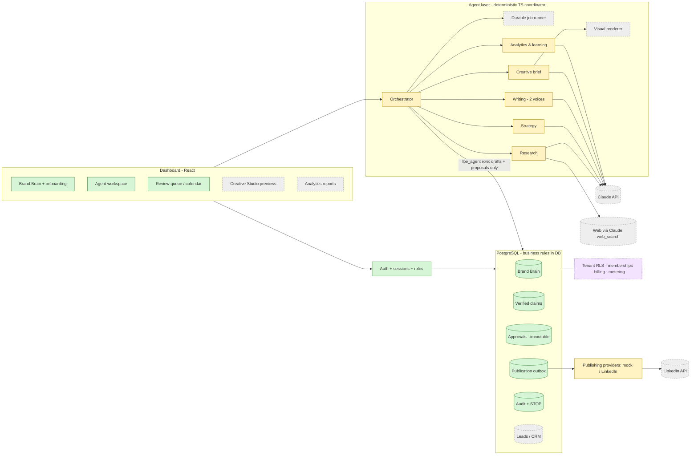

# plan.md — ActTrident AI LinkedIn Branding Agent

> **The single authoritative implementation and execution plan.** Read this (and `CLAUDE.md`) before any
> development. Architectural decisions live in [`docs/decisions/ADR-log.md`](docs/decisions/ADR-log.md); owner
> decisions in [`docs/owner-decisions.md`](docs/owner-decisions.md); owner to-dos in
> [`docs/owner-action-checklist.md`](docs/owner-action-checklist.md). If this plan and an ADR disagree, stop and
> reconcile them in both places before coding.
>
> Created 2026-11-19 from a full repository audit (commit `0989d12`). Task statuses:
> `NOT_STARTED` · `READY` · `IN_PROGRESS` · `BLOCKED` · `NEEDS_REVIEW` · `DONE` · `DEFERRED`.

---

## J. Progress dashboard (keep this section current)

| Item | Value |
|---|---|
| Current phase | **Phase 1 — Security & engineering foundation** (Phase 0 DONE) |
| Active task | — |
| Next READY tasks | **P1-03 user management** · P2-01 pillars UI · P4-01 durable jobs · P3-01 pricing check · P5-00 render dependency review |
| First safe milestone | **M1 Technical prototype hardened** — P1-01..05 + P2-01/02 need no external action |
| Completed this session | P0-01 … P0-06 (audit, baseline, plan, CLAUDE.md rule, owner checklist) · P1-01 backups · P1-02 sessions |
| Blocked (owner) | P2-08 real Brand Brain content · P3-04 paid evaluation · P6-01 founder LinkedIn app · P6-07 company app · P0-07 off-machine code backup |
| Owner actions required | See `docs/owner-action-checklist.md` (OA-1 … OA-9) |
| Latest passing tests | 2026-11-19: typecheck ✅ · Vitest 290 ✅ (9 PG skipped there) · `test:pg:embedded` 9/9 ✅ · Playwright 7 ✅ · secret scan ✅ · npm audit 0 ✅ |
| Latest commit | see `git log -1` (P1-02 follows `2ad93b5`) |
| Next milestone | **M1 Technical prototype hardened** → then **M2 AI intelligence evaluation** (needs OA-3, OA-6) |

No completion percentage is reported (no agreed weighting method).

---

## A. Product vision

A **standalone AI LinkedIn Branding Agent** — an AI branding team in one product, run by a non-technical owner.
It keeps a persistent, owner-approved **Brand Brain**; researches the market with verifiable sources; plans
campaigns; writes company-page and founder content in distinct voices; produces branded visuals and PDF
documents; routes every external action through **human approval**; publishes via **authorized LinkedIn
integrations**; reports permitted performance; and proposes improvements — never inventing facts or silently
rewriting the brand. Later it supports an **inbound-first** lead journey using first-party data only.

**Strategy (ADR-001, confirmed by owner 2026-11-19): internal ActTrident launch first (Customer Zero),
commercial multi-tenant SaaS later.** Keep SaaS boundaries (organizations, isolation, budgets) but do not build
billing, customer onboarding or enterprise features until Phase 10. Not related to the old `ai-social-media-team`.

---

## B. Current state (verified 2026-11-19, commit `0989d12`)

| Area | State | Evidence |
|---|---|---|
| Auth & sessions (in-DB, bcrypt, hashed tokens, lockout, CSRF origin check) | **Implemented & verified** | `tests/db/access-control`, `tests/integration/tenant-isolation` |
| Organization isolation (48 API routes, all definer functions) | **Verified for internal MVP**; RLS second layer missing (SaaS blocker) | ADR-023, `tenant-isolation` 15 tests |
| Approval binding, outbox, STOP (platform/org/account), audit | **Implemented & verified** incl. real-PostgreSQL concurrency | 87 DB tests, `npm run test:pg:embedded` 9/9 |
| Privileges (api/worker/agent roles) | **Verified**, snapshot test | `tests/db/function-security` |
| Migrations (forward-only, atomic, checksummed, upgrade-tested) | **Verified** | `tests/db/migration-upgrade`, `docs/migrations-runbook.md` |
| Brand Brain (13 sections, versioned, proposals, onboarding UI) | **Implemented & tested**; content: dev = synthetic, staging = empty | `brand-agent` 23 tests, `npm run brain:audit` |
| Agent workflow (research → strategy → 2 voices → visual briefs → checks → review) | **Mock-tested only**; Claude adapters type-checked, never called live | `brand-agent`, `agent-readiness`, eval runs NOT_READY (mock) |
| Evidence integrity (sources from tool, contradictions, restatement check, staleness, injection flags) | **Implemented & tested** (fake clients) | ADR-025 |
| Cost tracking & hard budget | **Implemented**; web-search price unverified | ADR-026 |
| Evaluation harness (isolated, gated paid runs, scoring sheet) | **Implemented** (mock runs only) | `docs/evaluation-plan.md` |
| Workflow execution | **Synchronous in HTTP request** — unsuitable for real models from the dashboard | hardening report §6 |
| Visual assets (images/PDF) | **Missing** (briefs only) | — |
| LinkedIn OAuth + live provider | **Contract-tested against a fake only; switched off** | `live-flow`, `linkedin-provider` |
| LinkedIn pilot (Stage 2.2) | **Prepared; blocked on owner** (app, users) | `npm run pilot:preflight` |
| Analytics & learning | Learning proposals from review decisions **implemented**; LinkedIn metrics **missing** | — |
| Lead intelligence | **Missing** (deferred to Phase 8) | — |
| Deployment / hosting / monitoring / backups | **Missing** (local only; no code remote, no DB backup tooling) | audit |

Environment: Windows 11, Node 26.13.1, Git 2.56, PGlite (dev/test), embedded PostgreSQL 18.6 (concurrency tests),
Docker Desktop installed but unusable (no WSL2 — not needed now). External dependencies not yet available:
Anthropic API key, LinkedIn developer apps, hosting.

---

## C. Architecture

Legend: green = implemented & verified · yellow = implemented, mock/fake-tested only · grey dashed = proposed ·
purple = SaaS (Phase 10). Key decisions: ADR-002 (replaceable orchestration), ADR-005/021 (DB-enforced gates,
agent role), ADR-014 (live gate, manual release), ADR-018 (Brand Brain), ADR-020 (Messages API + coordinator),
ADR-022 (STOP levels), ADR-023 (isolation status).

---

## D. Gap analysis

| # | Capability | Current | Desired | Why | Depends on | Size | Security | Acceptance |
|---|---|---|---|---|---|---|---|---|
| G1 | Data backup & restore | None; code has no remote | One-command DB backup + tested restore; code pushed to private remote | Real Brand Brain data is about to be entered | — / OA-1 | S | Backups contain business data; keep git-ignored/encrypted | Restore test passes; runbook |
| G2 | Single source for pillars | `social_accounts.pillars` (SQL only) + Brain `pillars_goals` text | Owner edits pillars per account in Brand Brain UI; Brain section holds goals narrative only | No duplicate truth; owner can't edit pillars today | — | S | Admin-only, audited | UI + DB function + tests |
| G3 | Session hardening | 12 h absolute, no idle timeout, no "sign out everywhere" | Idle timeout, revoke-all, admin user management | Internal real users | — | S | Core auth | Tests |
| G4 | Real AI validation | Mock only | Paid evaluation scored by humans | Quality unknown | OA-3, OA-6, P3-01 | M | Budget, key handling | Scoring sheet complete |
| G5 | Durable jobs | Synchronous request | Persisted jobs, progress, cancel, retry, restart recovery | Real runs take minutes | — | M | Job runner uses lbe_agent role | Kill/restart test |
| G6 | Visual assets | Briefs only | Branded PNG + PDF document carousels from templates | Complete content package | P5 templates | M | No remote fetch in renderer (SSRF) | Rendered assets attached to drafts |
| G7 | Content operations | Single draft per account; basic calendar | Revisions, monthly plan, campaign objectives | Usable workflow | G5 | M | — | E2E |
| G8 | LinkedIn live | Fake-only | One approved founder post live; company page later | Core value | OA-2, OA-4, OA-5 | M | Tokens, permissions | Pilot log signed |
| G9 | Analytics | None | Permitted aggregate metrics, weekly report | Learning loop | G8 + CM access | M | Member-data rules | Weekly report |
| G10 | Leads | None | Inbound lead capture → attribution | Business outcome | G8, privacy docs | L | UK GDPR/PECR | E2E lead journey |
| G11 | Production deployment | Local only | Hosted internal production with monitoring | Repeatable use without Claude session | OA-9 | L | Secrets, TLS, backups | Ops runbook + acceptance test |
| G12 | Tenant RLS & memberships | API filters + definer checks | RLS second layer, memberships | SaaS | Phase 10 | L | Core isolation | Multi-tenant security tests |

---

## E. Implementation phases & milestones

| Phase | Goal | Exit condition | Milestone |
|---|---|---|---|
| 0 | Baseline & plan | Evidence-backed baseline + this plan | — |
| 1 | Security & engineering foundation | Current-scope critical/high resolved or listed as launch blockers; backups proven | **M1 Technical prototype hardened** |
| 2 | Real Brand Brain | Structurally complete, onboarding tested, owner able to enter/approve; real content may remain an owner blocker | M1 |
| 3 | Real AI intelligence validation | Paid run scored by humans (accuracy + voice) | **M2 AI intelligence evaluation** |
| 4 | Reliable orchestration | Start → monitor → recover → review, no duplicates/lost state | **M3 Internal MVP** (with 5) |
| 5 | Content production & Creative Studio | Approval-ready package incl. real visuals | M3 |
| 6 | LinkedIn connection & safe publishing | One approved post published with confirmation, audit, recovery | **M4 Internal pilot** |
| 7 | Analytics & learning | Weekly evidence-backed report + approved learning | M4/M5 |
| 8 | Inbound lead intelligence | Content link → first-party capture → attributed outcome | post-M5 (separately scoped) |
| 9 | Internal production readiness | Repeatable operational product | **M5 Production internal launch** |
| 10 | Commercial SaaS | Explicit SaaS readiness review passed | **M6 SaaS readiness** |

Dependency order: 0 → 1 → 2 → (3 ∥ 4) → 5 → 6 → 7 → 9; 8 after 6 (+privacy); 10 after 9. Phases 3 and 4 can
proceed in parallel because the evaluation harness runs from the CLI, not the dashboard.

---

## F. Task register

Responsible: **C** = Claude (developer) · **O** = Owner · **X** = external approval (LinkedIn, legal, vendor).

### Phase 0 — Baseline & plan
| ID | Task | Deps | Pri | Status | Who | Files | Acceptance | Evidence |
|---|---|---|---|---|---|---|---|---|
| P0-01 | Audit repo, docs, git, tests | — | P0 | DONE | C | — | Baseline table §B | Audit 2026-11-19 |
| P0-02 | Re-verify all suites incl. PG concurrency | — | P0 | DONE | C | — | All green | §J latest tests |
| P0-03 | Create `plan.md` | P0-01 | P0 | DONE | C | plan.md | Sections A–K | this file |
| P0-04 | Add plan rule to `CLAUDE.md` | P0-03 | P0 | DONE | C | CLAUDE.md | Rule present | commit |
| P0-05 | Create `docs/owner-action-checklist.md` | P0-03 | P0 | DONE | C | docs/ | OA-1…9 with steps | commit |
| P0-06 | Reconcile ADRs with internal-first/SaaS-later; mark superseded docs | P0-03 | P1 | DONE | C | ADR-log, owner-decisions | ADR-027 recorded; D-04 answered | commit |
| P0-07 | Off-machine code backup (private Git remote) | — | P0 | BLOCKED | O | — | `git push` to private repo succeeds | OA-1 |

### Phase 1 — Security & engineering foundation
| ID | Task | Deps | Pri | Status | Who | Files | Acceptance | Verification |
|---|---|---|---|---|---|---|---|---|
| P1-01 | **DB backup & tested restore** (`db:backup`, `db:restore`; PGlite now, `pg_dump` documented for PostgreSQL URLs). **Evidence 2026-11-19:** `tests/db/backup-restore.test.ts` 5/5; staging backup + verified restore (6 migrations, 13 rows); refusals verified (server running, non-empty target, outside `.data/`) | — | P0 | DONE | C | scripts/, services/api/src/cli, docs/migrations-runbook.md | Backup of dev & staging; restore into new dir reproduces row counts & checksums; refuses to overwrite a running/live DB | `tests/db/backup-restore.test.ts`, manual run |
| P1-02 | Session hardening: idle timeout (60 min, DB-enforced in `require_user`/`whoami`), sign-out-everywhere (`lbe.logout_all`, `POST /api/auth/logout-all`, dashboard button + "session ended" notice). **Evidence 2026-11-19:** `tests/db/sessions.test.ts` 7/7 (mutation: removing idle check → 1 failure); api-flow +2; e2e +1 (7/7); privilege snapshot updated; PG concurrency 9/9 | — | P1 | DONE | C | migration 0700, app.ts, web | Idle sessions rejected; revoke-all works; tests | `tests/db/sessions.test.ts` |
| P1-03 | Admin user management UI (create/disable users, approver assignment, admin "end user's sessions"; disabling revokes sessions) — no emails | P1-02 | P1 | READY | C | migration, app.ts, web | Admin-only; audited; org-scoped; tests | integration test |
| P1-04 | Structured error logging & request IDs (no secrets/PII in logs) | — | P2 | NOT_STARTED | C | app.ts | Every 5xx logged with request id; secret-leak test still passes | test |
| P1-05 | Security review sign-off for internal MVP; list SaaS blockers | P1-01..04 | P1 | NOT_STARTED | C | docs/hardening-report.md | Findings table updated | doc |

### Phase 2 — Real Brand Brain
| ID | Task | Deps | Pri | Status | Who | Files | Acceptance | Verification |
|---|---|---|---|---|---|---|---|---|
| P2-01 | **Pillars single source**: owner edits account pillars in Brand Brain UI (DB function, audit); `pillars_goals` = goals narrative | — | P1 | READY | C | migration, app.ts, agentPages.tsx | Admin edit; existing content unaffected; agents use updated pillars; tests | integration test |
| P2-02 | Onboarding wizard: step-by-step order, progress, "UNKNOWN is OK" guidance, claims step linking to Claims register | P2-01 | P1 | NOT_STARTED | C | web | Beginner can complete without docs; e2e test | Playwright |
| P2-03 | Document import improvements: file upload (txt/md/pdf→text) for proposals | P2-02 | P2 | NOT_STARTED | C | app.ts, web | Grounded proposals only; size limits; tests | test |
| P2-04 | Account display names / founder name editable (admin) | P2-01 | P2 | NOT_STARTED | C | migration, web | Audited; tests | test |
| P2-05 | Retire synthetic dev knowledge path: `brain:reset-dev` (dev only) | — | P3 | NOT_STARTED | C | cli | Refuses on staging | test |
| P2-06 | Staging bootstrap for real use (`staging:init` + admin user) | — | P1 | BLOCKED | O | — | Pre-flight passes user checks | OA-2 |
| P2-07 | Import brand/voice files decision (keep or replace placeholders) | — | P3 | DONE | C | — | Placeholder files flagged by audit | ADR-018 |
| P2-08 | **Owner enters real Brand Brain + 3–5 verified claims** in staging | P2-06 | P0 | BLOCKED | O | — | `brain:audit:staging` shows no UNKNOWN required / no synthetic | OA-3 |

### Phase 3 — Real AI intelligence validation
| ID | Task | Deps | Pri | Status | Who | Files | Acceptance | Verification |
|---|---|---|---|---|---|---|---|---|
| P3-01 | Verify official pricing (incl. web search) & model availability; update `cost.ts` | — | P1 | READY | C | services/agents/src/cost.ts, ADR-026 | Prices cited with URL+date; tests updated | unit tests |
| P3-02 | Make mock drafter produce length-compliant posts (so mock evals test the pipeline, not template length) | — | P3 | NOT_STARTED | C | mock-drafter | Mock eval no longer fails on length only | eval run |
| P3-03 | Prompt review for real models (ICP-aware strategy, originality instructions, length) | P3-01 | P2 | NOT_STARTED | C | prompts | Reviewed against Brand Brain sections | review |
| P3-04 | **Paid evaluation run** (budget-capped) from staging snapshot | P2-08, P3-01, OA-6 | P0 | BLOCKED | O+C | eval-results/ | Run completes within budget | `eval:campaign --provider anthropic` |
| P3-05 | Human scoring of P3-04 output | P3-04 | P0 | BLOCKED | O | scoring-sheet.md | Accuracy & voice scored | sheet |
| P3-06 | Tune prompts/validators from scores; re-run (budgeted) | P3-05 | P1 | NOT_STARTED | C | agents | Scores improve or issues documented | eval |

### Phase 4 — Reliable orchestration
| ID | Task | Deps | Pri | Status | Who | Files | Acceptance | Verification |
|---|---|---|---|---|---|---|---|---|
| P4-01 | Durable job table + runner (claim/lease like outbox, lbe_agent role) | — | P1 | READY | C | migration 07xx, services/agents, api | Jobs persisted; one runner claims; lease expiry → resumable | DB + PG concurrency tests |
| P4-02 | Step checkpoints & safe partial results (resume after crash without duplicate drafts) | P4-01 | P1 | NOT_STARTED | C | orchestrator | Kill mid-run → resume → no duplicates | integration test |
| P4-03 | Cancel, retry, timeouts per step; per-run cost on job | P4-01 | P1 | NOT_STARTED | C | orchestrator, api | Cancel stops further model calls | tests |
| P4-04 | Dashboard progress view (polling) | P4-01 | P2 | NOT_STARTED | C | web | Progress & cost visible; e2e | Playwright |
| P4-05 | Safe parallelism (drafts per item) with budget awareness | P4-02 | P3 | NOT_STARTED | C | orchestrator | Faster, same results; budget respected | tests |

### Phase 5 — Content production & Creative Studio
| ID | Task | Deps | Pri | Status | Who | Files | Acceptance | Verification |
|---|---|---|---|---|---|---|---|---|
| P5-00 | **Gate:** dependency review for Satori / resvg-js / pdfkit (licence, maintainers, native binaries, 14-day cooldown, install scripts) recorded in ADR dependency table | — | P1 | READY | C | ADR-log | Approved versions pinned or alternative chosen | ADR entry |
| P5-01 | Render service (Satori + resvg-js + pdfkit — selected in research) | P5-00 | P1 | NOT_STARTED | C | services/render | No network egress; data-URI assets; tests | unit tests |
| P5-02 | Brand templates (single image, document carousel) from Brand Brain identity (placeholder identity until P2-08) | P5-01 | P1 | NOT_STARTED | C | templates | Rendered PNG/PDF previews | snapshot tests |
| P5-03 | Attach assets to drafts (media ids in package → approval covers visuals) | P5-02 | P1 | NOT_STARTED | C | migration, api | Editing visual invalidates approval | DB tests |
| P5-04 | Draft revisions & history view | P4-02 | P2 | NOT_STARTED | C | web, api | Version diff visible | e2e |
| P5-05 | Monthly planning & campaign objectives | P4-04 | P2 | NOT_STARTED | C | agents, web | Month plan without duplicates | tests |
| P5-06 | Accessibility (alt text required for visuals, keyboard nav check) | P5-03 | P2 | NOT_STARTED | C | web | axe checks pass | Playwright |

### Phase 6 — LinkedIn connection & safe publishing
| ID | Task | Deps | Pri | Status | Who | Files | Acceptance | Verification |
|---|---|---|---|---|---|---|---|---|
| P6-01 | Founder app created; secrets in `.env.staging` | — | P0 | BLOCKED | O | — | Pre-flight passes | OA-4 |
| P6-02 | Pilot: test profile connect + read-only verify | P6-01, P2-06 | P0 | BLOCKED | O+C | pilot log | U1–U3, U6 recorded | `pilot:verify` |
| P6-03 | Pilot: one approved live post (owner present) | P6-02 | P0 | BLOCKED | O+C | pilot log | Post visible; URN stored; audit complete | pilot log |
| P6-04 | Media upload (images/documents) for live provider | P5-03, P6-03 | P2 | NOT_STARTED | C | publishing | Contract tests + pilot | tests |
| P6-05 | Token expiry reminders & reconnect UX | P6-02 | P2 | NOT_STARTED | C | web | Warnings at 14/3 days (exists) + reconnect flow verified live | pilot |
| P6-06 | Legal answer on scheduled release (§3.1(26)) | — | P1 | BLOCKED | O/X | — | Written answer | OA-7 |
| P6-07 | Company app + Community Management review | — | P1 | BLOCKED | O/X | — | Approved by LinkedIn | OA-5 |

### Phase 7 — Analytics & learning
| ID | Task | Deps | Pri | Status | Who | Acceptance |
|---|---|---|---|---|---|---|
| P7-01 | Aggregate post metrics ingest (company page via CM; founder if permitted) | P6-07 / U-checks | P1 | NOT_STARTED | C | Metrics stored ≤1 yr, aggregates only |
| P7-02 | Weekly branding report (facts vs hypotheses labelled) | P7-01 | P1 | NOT_STARTED | C | Report generated from stored data only |
| P7-03 | UTM links on posts + site analytics (Umami) | P8-01 | P2 | NOT_STARTED | C | Clicks attributed |
| P7-04 | Learning proposals from metrics (extends existing review-based learning) | P7-02 | P2 | NOT_STARTED | C | Evidence-linked proposals |

### Phase 8 — Inbound lead intelligence (separately scoped; after Phase 6)
| ID | Task | Deps | Status | Who |
|---|---|---|---|---|
| P8-01 | Privacy notice, LIA, retention policy | OA-8 | BLOCKED | O/X |
| P8-02 | Lead-magnet landing page + consented capture | P8-01 | NOT_STARTED | C |
| P8-03 | Leads/companies/consent/suppression schema + dedup | P8-02 | NOT_STARTED | C |
| P8-04 | Explainable fit/intent scoring (first-party evidence only) | P8-03 | NOT_STARTED | C |
| P8-05 | Follow-up drafts with approval + suppression trigger | P8-04 | NOT_STARTED | C |
| P8-06 | Meetings/opportunities + attribution | P8-03 | NOT_STARTED | C |

### Phase 9 — Internal production readiness
| ID | Task | Deps | Status | Who |
|---|---|---|---|---|
| P9-01 | Hosting decision (owner) & deployment architecture | OA-9 | BLOCKED | O+C |
| P9-02 | Real-user auth (SSO or MFA) | P1-02 | NOT_STARTED | C |
| P9-03 | Secrets management, TLS, environment separation | P9-01 | NOT_STARTED | C |
| P9-04 | Automated backups + restore drill | P1-01, P9-01 | NOT_STARTED | C |
| P9-05 | Monitoring, alerting, incident runbook (incl. LinkedIn 24 h incident rule) | P9-01 | NOT_STARTED | C |
| P9-06 | Retention jobs, privacy docs, accessibility review | P8-01 | NOT_STARTED | C |
| P9-07 | Internal acceptance test with real approved content | all above | NOT_STARTED | O+C |
| P9-08 | Deployment approval | P9-07 | BLOCKED | O |

### Phase 10 — Commercial SaaS (DEFERRED until M5)
P10-01 org RLS second layer · P10-02 memberships · P10-03 customer onboarding · P10-04 per-tenant OAuth/apps ·
P10-05 billing & metering · P10-06 tenant AI budgets · P10-07 per-tenant key separation · P10-08 support admin ·
P10-09 tenant retention/deletion · P10-10 DPA/terms/sub-processors · P10-11 multi-tenant pen test ·
P10-12 licence re-verification. All **DEFERRED** (ADR-001, ADR-023 gaps 1–6).

---

## G. Decision register

| Decision | Status | Where |
|---|---|---|
| Internal-first, SaaS-later | **Decided** (owner) | ADR-001, ADR-027, D-04 |
| Manual release until legal clears §3.1(26) | Decided | P2-D1, ADR-014 |
| Runtime: Messages API + deterministic coordinator | Decided | ADR-020 |
| Paid evaluation key + budget + authorization | **Open** | D-06, OA-6 |
| Real Brand Brain content | **Open** (owner input) | D-07, OA-3 |
| LinkedIn apps (founder, company) | **Open** | D-02, P2-D4/D5, OA-4/5 |
| Legal: scheduled release; privacy/LIA | **Open** | D-03, D-11, OA-7/8 |
| SSO/Supabase Auth before multi-user production | Open | D-05 |
| Hosting for internal production | Open | D-09, OA-9 |
| Docker Desktop licence | Moot for now (Docker not needed) | D-10 |
| Off-machine code backup | **Open** | OA-1 |

---

## H. Testing & quality gates

**Every task:** `npm run typecheck` · `npm test` · relevant new tests · `npm run security:secrets` · no regression.
**DB-affecting tasks:** also `npm run test:pg:embedded` and the privilege snapshot (`function-security`) updated deliberately.
**UI-affecting tasks:** `npm run test:e2e`.

| Gate | Must pass |
|---|---|
| M1 Technical prototype hardened | All suites green; P1-01..05 done; backup restore proven; no open critical/high |
| M2 AI intelligence evaluation | P2-08 done; paid run within budget; human scores recorded for accuracy & voice; no fabricated facts found |
| M3 Internal MVP | Durable jobs (kill/resume test); visual assets; owner completes a campaign end-to-end in the UI |
| M4 Internal pilot | Pilot log signed: live post, URN, audit, STOP demonstrated, reconciliation path tested |
| M5 Production internal launch | Deployment, backups drill, monitoring, real-user auth, acceptance test, owner approval |
| M6 SaaS readiness | Phase 10 complete + external security review |

Failure handling: record → classify (product vs test defect) → fix root cause → re-run → regression → update plan.

---

## I. Risks & mitigations

| Risk | Type | Mitigation |
|---|---|---|
| Laptop loss (no code remote, no DB backup) | Operational | P1-01 + OA-1 |
| AI fabricates or misattributes facts | AI quality | Claims register, restatement check, human scoring (ADR-025/026) |
| Content quality unknown (mock only) | Product | Phase 3 paid evaluation before UI rollout |
| LinkedIn treats scheduled release as automated posting | Platform/legal | Manual release (ADR-014); OA-7 |
| LinkedIn permissions differ from docs | API | Pilot verification U1–U6; capability register |
| Token leakage | Security | AES-GCM, key outside DB, no logging (ADR-015) |
| Cross-tenant leak when SaaS | Security | ADR-023 gaps → Phase 10 RLS |
| Cost overrun | Vendor | Hard budget; unknown models priced ∞; P3-01 pricing verification |
| Unsigned embedded PostgreSQL binary | Supply chain | Dev-only, isolated, registry signature verified; hash recorded |
| Beta dependencies (embedded-postgres beta tag, server-side fallback beta) | Vendor | Dev-only / optional; pinned |
| Single-process in-memory rate limiting | Security | Acceptable internal; revisit at P9 |
| Docker licence | Licensing | Not used currently |
| UK GDPR/PECR for leads | Privacy | Phase 8 gated on P8-01 |

---

## K. Definition of Done

1. **Technical prototype (M1):** all automated suites green incl. real-PostgreSQL concurrency; security findings
   closed or listed; backups restorable; plan current.
2. **AI intelligence evaluation (M2):** real Brand Brain; paid Claude run of the phishing campaign within budget;
   human scoring shows factual accuracy and voice acceptable (owner judgement) with issues logged.
3. **Internal ActTrident MVP (M3):** owner runs a campaign from the dashboard (durable jobs), reviews drafts with
   real visuals, approves, mock-publishes, sees audit — without a Claude Code session.
4. **Internal pilot (M4):** one approved post published live via authorized founder account; confirmation,
   audit, STOP and recovery demonstrated; company page if approved by LinkedIn.
5. **Production internal launch (M5):** hosted, backed up, monitored, real-user auth, runbooks, acceptance test
   passed, owner deployment approval. Lead capture is a **separate later milestone** unless explicitly scoped in.
6. **Commercial SaaS readiness (M6):** Phase 10 complete, external security review, legal/commercial terms.

---

## Change log
| Date | Change | Commit |
|---|---|---|
| 2026-11-19 | Plan created from audit (P0-01…P0-06) | `6429aaa` |
| 2026-11-19 | Review: removed false deps (P4-01→P1-01, P5-02→P2-08), added P5-00 dependency gate, trimmed P1-02; P1-01 DONE | P1-01 commit |
